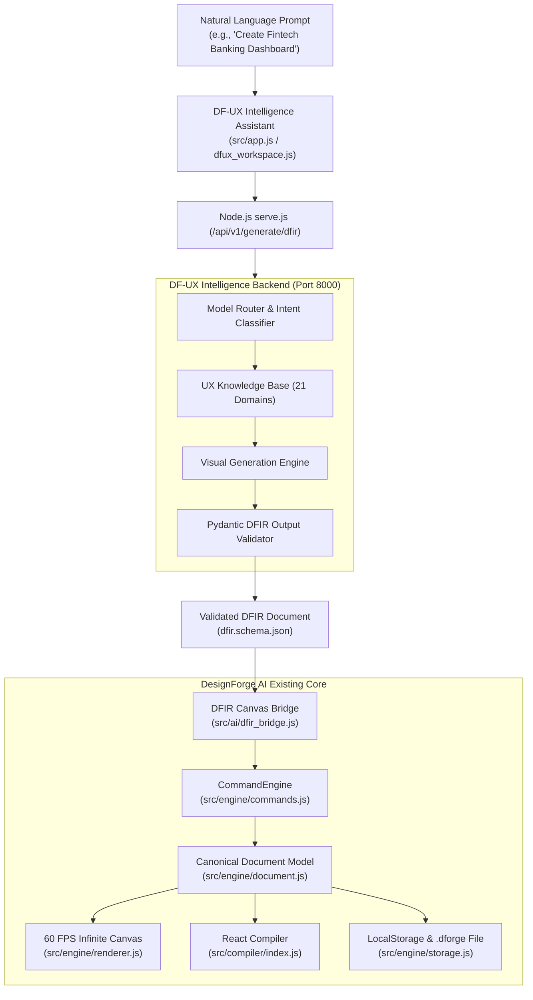

# DF-UX Intelligence — Existing Features & Dependency Map
**Application:** DesignForge AI  
**Module:** DF-UX Intelligence  
**Version:** 1.0.0-alpha  
**Date:** November 2026  

---

## 1. Feature Map & Preservation Matrix

This map catalogs every existing module of DesignForge AI, its underlying implementation files, how it integrates with DF-UX Intelligence, and the explicit preservation guarantee.

| Subsystem | Existing Module / Files | Integration Touchpoint for DF-UX | Preservation Guarantee |
|---|---|---|---|
| **Canvas & 2D Rendering** | `src/engine/renderer.js` | Receives translated DFIR nodes via `CommandEngine`. Renders transformed nodes, handles, snap lines. | **100% Preserved**. No modifications to 60 FPS render loop or hit-testing math. |
| **Document Scene Graph** | `src/engine/document.js`, `document-v1.schema.json` | DFIR nodes convert 1:1 into canonical document nodes (`createNode`). | **100% Preserved**. Canonical schema version `1.0.0` intact. |
| **Transactional Commands** | `src/engine/commands.js` | DFIR mutations dispatch as `batchOperations` or discrete commands (`addNode`, `applyLayout`). | **100% Preserved**. Full undo/redo (`⌘Z`/`⌘⇧Z`) history maintained. |
| **Design Tokens & System** | `src/engine/design_system/`, `src/engine/palette.js` | DF-UX extracts active tokens and injects new semantic tokens (`UpdateTokens`). | **100% Preserved**. Mantine, MUI, AG Grid registry intact. |
| **React & TSX Compiler** | `src/compiler/index.js`, `src/compiler/jsx.js` | Design-to-code engine can either use existing `ReactCompiler` or export full TSX bundles. | **100% Preserved**. Sandboxed iframe preview remains functional. |
| **Prototyping Engine** | `src/engine/prototype.js`, `src/editor-core/advanced-prototype-engine.js` | Prototyping intelligence engine populates `interaction` and `transition` properties. | **100% Preserved**. Flow player and device bezels intact. |
| **Workspace & Multi-File** | `src/engine/workspace_store.js` | DF-UX projects save as standard workspaces and `.dforge` archives. | **100% Preserved**. Tabs, projects, and versioning intact. |
| **Authentication & RBAC** | `src/engine/auth_service.js` | DF-UX backend respects user role (`admin`, `editor`, `viewer`) for model access. | **100% Preserved**. Local and cloud auth flows intact. |
| **Existing AI Gateway** | `src/engine/ai.js`, `src/ai/service.js` | Extended to query DF-UX FastAPI backend (`/api/v1/*`) alongside legacy providers. | **100% Preserved**. Ollama, OpenAI, Gemini providers remain available as fallbacks. |
| **Desktop Application Shell** | `src/app.js`, `index.html` | Adds DF-UX topbar launcher, dedicated 12-section view, and improved AI sidebar tabs. | **100% Preserved**. Keyboard shortcuts, menus, and inspector panels remain active. |
| **Dev Server & API Proxy** | `serve.js` | Node.js server proxies `/api/v1/*` requests to the local Python FastAPI server on port 8000. | **100% Preserved**. Vite middleware and `/api/preview` intact. |

---

## 2. Dependency Flow Diagram

---

## 3. Extension vs Duplication Rules

1. **Do not create a duplicate canvas:** All generated shapes and components render through `src/engine/renderer.js`.
2. **Do not create an isolated document format:** DFIR strictly compiles into `src/engine/document.js` nodes.
3. **Do not bypass the command engine:** Every canvas change from DF-UX Intelligence is committed via `CommandEngine` so the user can hit `⌘Z` (Undo) at any time.
4. **Preserve existing providers:** Users can continue using their existing API keys for direct OpenAI or Gemini calls if desired.
5. **Re-use existing design token collections:** New styles align with `tokens_colors`, `tokens_spacing`, and `tokens_radius` defined in the active document.
