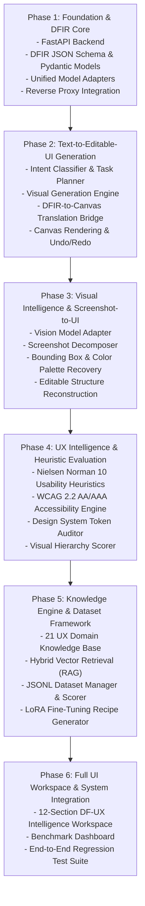

# DF-UX Intelligence — Phased Implementation Plan
**Application:** DesignForge AI  
**Module:** DF-UX Intelligence  
**Version:** 1.0.0-alpha  
**Date:** November 2026  

---

## 1. Implementation Methodology & Guidelines

To ensure non-negotiable stability of DesignForge AI, all development follows strict progressive staging:
1. **Zero Degradation:** Existing canvas rendering (`renderer.js`), command history (`commands.js`), compiler (`compiler/`), and document serialization (`storage.js`) must never be broken or overwritten.
2. **Schema-First:** Every generated design element must conform to `dfir.schema.json` before touching the canvas.
3. **Verification Checkpoints:** Each phase includes automated unit tests, API tests, and UI integration checks.
4. **Mock Transparency:** Temporary mock models are clearly labeled; live endpoints and health checks reflect real system states.

---

## 2. Phase Breakdown & Execution Sequence

---

### Phase 1: Foundation & DFIR Core Standard

#### Objectives:
- Establish the Python FastAPI backend in `LLM/app`.
- Author the formal `dfir.schema.json` and Pydantic v2 data models.
- Build the unified `ModelManager` and initial adapters (`OllamaAdapter`, `OpenAIAdapter`, `GeminiAdapter`, `MockAdapter`).
- Connect Node.js `serve.js` reverse proxy to route `/api/v1/*` to the FastAPI backend.
- Write unit tests for schema validation and model adapters.

#### Deliverables:
- `LLM/schema/dfir.schema.json` & `LLM/schema/DFIR_TYPES.md`.
- `LLM/app/models/dfir.py` (Pydantic v2 models).
- `LLM/app/model_manager/manager.py` & adapters (`local_ollama.py`, `openai_adapter.py`, `gemini_adapter.py`, `mock_adapter.py`).
- `LLM/app/main.py` with `/api/v1/models`, `/api/v1/models/health`, `/api/v1/generate/dfir`.
- Reverse proxy route in `serve.js` for `/api/v1/*`.
- Automated test: `pytest LLM/tests/test_dfir_schema.py`.

---

### Phase 2: Text-to-Editable-UI Generation & Canvas Integration

#### Objectives:
- Build `IntentClassifier`, `TaskPlanner`, and `VisualGenerationEngine`.
- Implement client-side `src/ai/dfir_bridge.js` to translate validated DFIR trees directly into native DesignForge nodes (`createNode`) and commit them via `CommandEngine.execute`.
- Add prompt-to-UI action in the DesignForge AI Assistant panel.
- Ensure auto-layout, typography, and design tokens are properly applied.

#### Deliverables:
- `LLM/app/engines/visual_generation.py`.
- `LLM/app/orchestration/intent.py` & `LLM/app/orchestration/planner.py`.
- `src/ai/dfir_bridge.js` (DFIR ⇄ Canvas Document mapper).
- Frontend integration in `src/app.js` with plan preview, diff viewer, and "Apply to Canvas".
- Automated test: `tests/test_dfir_canvas_integration.js`.

---

### Phase 3: Visual Intelligence & Screenshot-to-UI

#### Objectives:
- Implement `VisionAnalysisEngine` for parsing uploaded UI screenshots.
- Deconstruct screenshots into semantic layout regions (Header, Nav, Hero, Cards, Tables, Forms).
- Extract color swatches, font hierarchies, and approximate layout bounds.
- Synthesize editable DFIR structures from vision analysis results.

#### Deliverables:
- `LLM/app/engines/vision_analysis.py`.
- API route: `POST /api/v1/analyze/screenshot`.
- Screenshot upload dropzone and component tree previewer in the frontend.
- Automated test: `LLM/tests/test_vision_analysis.py`.

---

### Phase 4: UX Intelligence, Heuristics & Accessibility Audits

#### Objectives:
- Build `UXReasoningEngine` applying Nielsen Norman heuristics, cognitive psychology rules, and information architecture best practices.
- Build `AccessibilityEngine` performing automated WCAG 2.2 AA and AAA contrast checks, touch target size calculations, keyboard focus ordering, and semantic tag validation.
- Build `DesignSystemEngine` to analyze token usage and recommend components from Mantine/MUI registries.

#### Deliverables:
- `LLM/app/engines/ux_reasoning.py`.
- `LLM/app/engines/accessibility.py`.
- `LLM/app/engines/design_system.py`.
- API routes: `POST /api/v1/evaluate/ux`, `POST /api/v1/design-system/recommend`.
- Visual audit report overlay on the canvas and in the inspector panel.
- Automated test: `LLM/tests/test_ux_engines.py`.

---

### Phase 5: Knowledge Engine (RAG) & Dataset Framework

#### Objectives:
- Establish the 21-domain UX knowledge base (Gestalt, visual hierarchy, mobile patterns, enterprise tables, etc.).
- Build the hybrid RAG retriever (`LLM/app/knowledge/rag_engine.py`) with semantic chunking and metadata filtering.
- Implement the `DatasetManager` to import, validate, curate, quality-score, and export JSONL datasets for LoRA/PEFT training.
- Generate Hugging Face PEFT/LoRA training configurations for Qwen3-32B and Gemma 4.

#### Deliverables:
- `LLM/app/knowledge/categories.py`, `chunker.py`, `rag_engine.py`.
- `LLM/app/knowledge/datasets/` with curated starter datasets.
- API routes: `GET/POST /api/v1/knowledge/*`, `GET/POST /api/v1/datasets/*`.
- Training recipe generator for LoRA/PEFT.
- Automated test: `LLM/tests/test_rag.py`.

---

### Phase 6: Integrated DF-UX Workspace & Acceptance Verification

#### Objectives:
- Implement the dedicated 12-section DF-UX Intelligence workspace UI in DesignForge AI.
- Add Model Manager panel with latency, context window, and test connection buttons.
- Implement the multi-metric Benchmark Evaluation dashboard.
- Run complete end-to-end regression tests across all existing DesignForge suites and new DF-UX modules.

#### Deliverables:
- Integrated workspace view in `src/app.js` and `index.html`.
- DF-UX Intelligence styles in `src/styles/dfux.css`.
- Verification against all Section 16 acceptance criteria:
  - Valid DFIR generation: ≥ 95%
  - Component resolution: ≥ 98%
  - Design token validity: ≥ 98%
  - Canvas rendering fidelity: ≥ 95%
- Comprehensive developer documentation and user guide.
