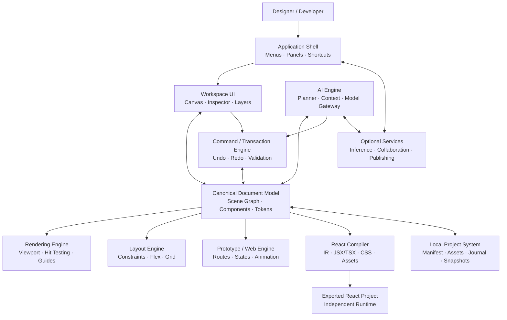
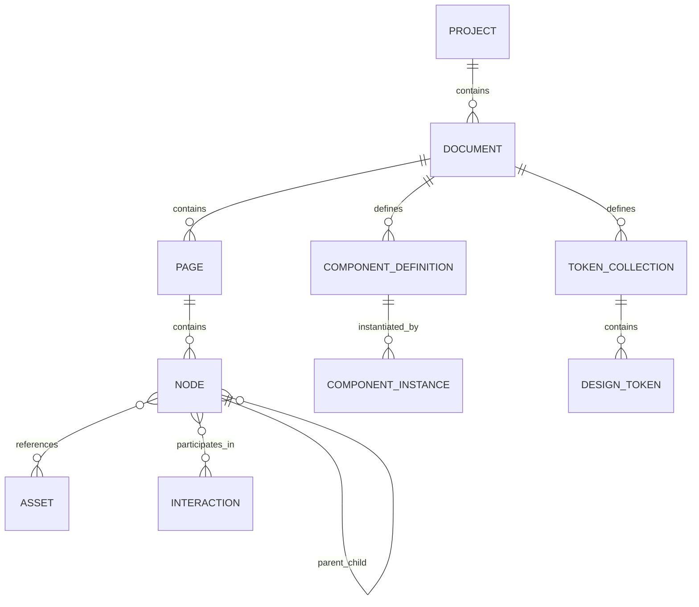
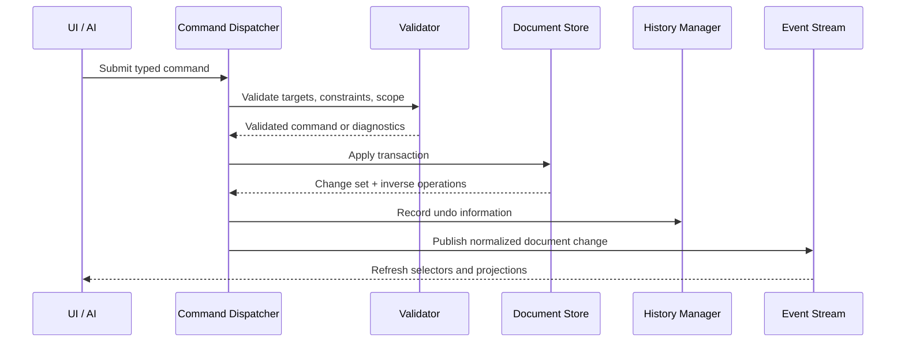
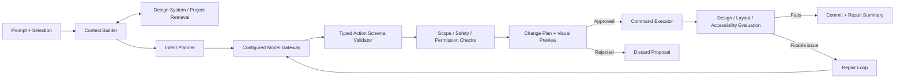
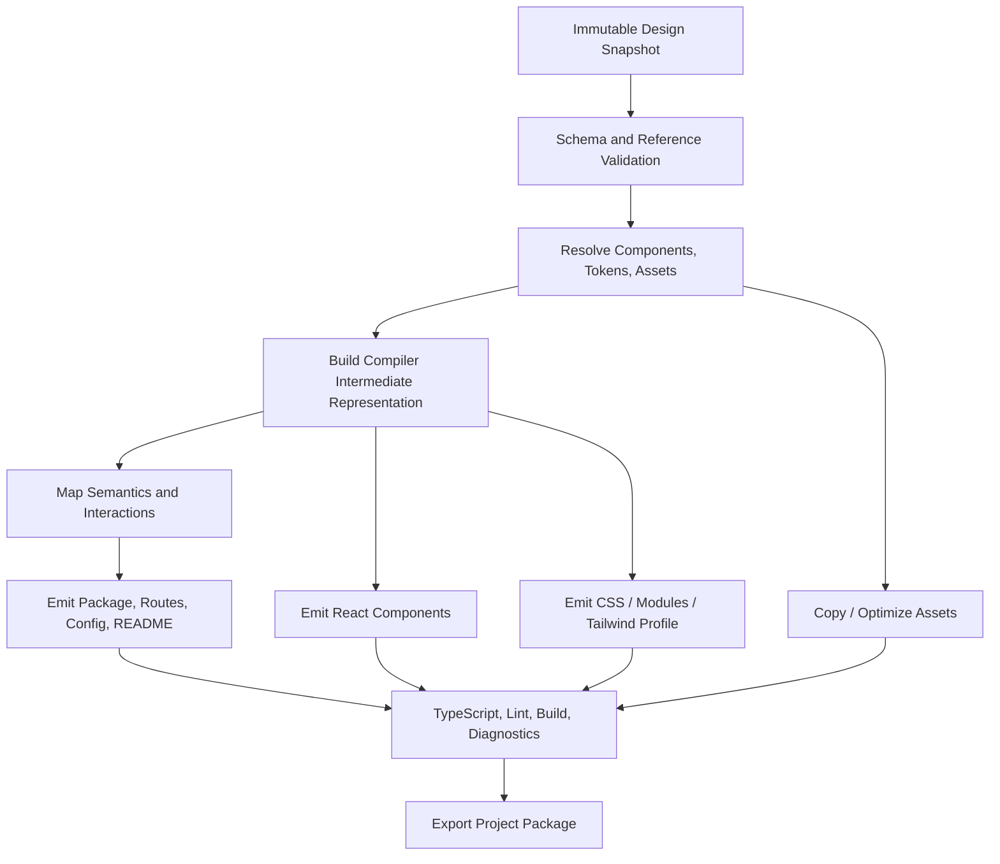

# DesignForge AI — Recommended Product Architecture

**Document type:** Product and technical architecture specification  
**Status:** Proposed baseline for implementation planning  
**Product:** DesignForge AI  
**Scope:** AI-native visual design, prototyping, website building, and design-to-React platform  
**Primary platforms:** macOS, Windows, Linux; web-based preview/export tooling where appropriate

---

## 1. Executive Summary

DesignForge AI is a desktop-first, object-based visual design platform combining the core workflows of professional interface design tools with an AI design assistant, responsive website/prototype tooling, and a deterministic design-to-React compiler.

The product should be built as a set of well-separated engines connected by stable data contracts:

1. **Application Shell** — windowing, menus, panels, commands, keyboard shortcuts, preferences, and desktop integration.
2. **Document and Design Engine** — canonical editable document model, scene graph, geometry, layout, vector/text objects, components, tokens, and transactions.
3. **Rendering and Interaction Engine** — canvas rendering, hit testing, selection, pan/zoom, guides, and high-performance viewport updates.
4. **AI Engine** — model gateway, project-context retrieval, intent planning, typed design operations, safeguards, evaluation, and repair.
5. **Prototype and Web Engine** — interactive states, navigation, responsive preview, animation, and website-specific behaviors.
6. **React Compiler** — converts the canonical document model into maintainable React/TypeScript/CSS source, assets, and buildable project structure.
7. **Local Project and Persistence System** — portable project packages, versioned serialization, autosave, recovery, assets, snapshots, and export metadata.
8. **Optional Collaboration and Extension Services** — real-time collaboration, shared libraries, plugins, comments, publishing adapters, and team controls.

The most important architecture rule is that **the design document is the source of truth**. The canvas renderer displays that document; the AI edits it through validated operations; the prototype player interprets its interactions; and the React compiler translates it into source code. None of these subsystems should maintain a separate, conflicting version of the design.

### Product outcome

A designer can create or import a design, modify it manually or through AI, save it as an editable local project, prototype it, and compile it into a runnable React project that does not require DesignForge AI at runtime.

### Implementation recommendation

Start with a modular monolith in a cross-platform desktop shell. Establish strict module boundaries and contracts, but do not begin with a large microservice architecture. A self-hosted model-serving process and optional remote collaboration services can be separate deployables because their compute and deployment requirements differ from the desktop application.

---

## 2. Architectural Principles

### 2.1 Canonical editable document

Every design element must exist as a structured object with a stable ID, type, properties, parent relationship, and ordering information. Screenshots or flattened raster output may be used for previews, references, or visual comparisons, but never as the only representation of an editable design.

### 2.2 One source of truth, multiple projections

The canonical document is consumed by the renderer, inspector, AI context builder, prototype runtime, asset exporter, and React compiler. These consumers may build caches or derived representations, but they must be disposable projections of the canonical document.

### 2.3 Command-based mutation

All document changes pass through a command/transaction layer. This enables consistent undo/redo, validation, event emission, AI edits, collaboration operations, and auditability.

### 2.4 Deterministic core, AI-assisted judgment

Use deterministic software for geometry, layout rules, serialization, token resolution, code emission, and validation wherever possible. Use AI for tasks that benefit from interpretation or reasoning: converting intent to a plan, selecting components, naming, refactoring suggestions, complex layout proposals, and code-quality assistance.

### 2.5 Progressive capability delivery

Feature groups must become usable end-to-end before moving on. A smaller reliable design-to-export workflow is more valuable than a broad interface containing placeholder controls.

### 2.6 Local-first project ownership

Projects should be editable offline and portable. Remote AI, collaboration, publishing, and team libraries are optional capabilities with explicit user consent and clear status indicators.

### 2.7 Cross-platform consistency

Keyboard commands, selection behavior, canvas navigation, and edit semantics must use a platform-aware command system rather than scattering operating-system checks throughout the codebase.

### 2.8 Observable and recoverable operations

Expensive or failure-prone operations—AI generation, import, compilation, publishing, autosave, collaboration synchronization—must provide clear progress, diagnostics, cancellation where practical, and recovery paths.

---

## 3. System Context

### 3.1 High-level architecture



### 3.2 Primary data flow

- **Manual edit:** User action → command → validation → transaction → canonical document update → affected render/layout projections refresh → autosave journal update.
- **AI edit:** User prompt → context retrieval → intent plan → structured operation proposal → schema and scope validation → preview/diff → approval when required → command transaction → document update.
- **Export:** Selected page/component/document → canonical document snapshot → compiler intermediate representation → component/layout/style generation → assets and manifest → validation/build checks → project package and diagnostics.
- **Prototype:** Document snapshot + interaction graph + runtime configuration → prototype interpreter → interactive preview.

---

## 4. Recommended Technology Baseline

These are architectural defaults, not immutable requirements. Validate specific library versions, licenses, platform support, and performance through a technical spike before committing to them.

| Layer | Recommended starting point | Rationale |
|---|---|---|
| Desktop shell | Tauri or an equivalent secure cross-platform shell | Native menus, file access, installers, and smaller desktop packaging than a full browser bundle in many cases |
| UI | React + TypeScript | Mature ecosystem for panels, inspectors, dialogs, and application state |
| UI styling | CSS variables plus design tokens; component library for application chrome | Keeps the editor UI consistent while allowing a custom design system |
| Canvas abstraction | Internal renderer interface; start with Canvas/SVG hybrid or a proven GPU renderer | Lets the product change rendering strategy without rewriting document semantics |
| Document model | Typed TypeScript domain model with normalized object storage | Stable IDs, validation, controlled mutations, serialization, and compiler compatibility |
| UI state | A small state container such as Zustand or Redux Toolkit for transient workspace state | Keeps panel and selection state separate from the canonical document |
| Layout engine | Internal layout contract with an adapter to a suitable layout implementation | Shared behavior between canvas, preview, and compiler |
| Local persistence | Versioned project package; JSON or another structured representation plus separate asset files; journaling and snapshots | Portable project files and recoverability |
| Local metadata index | SQLite or equivalent when recent-project indexing and richer metadata are needed | Fast local search and application-level metadata without changing the project package format |
| AI orchestration | Typed model gateway and tool/action executor | Separates product logic from any single inference provider |
| Model serving | Configurable local/self-hosted inference adapter and optional remote inference adapter | Supports privacy and model replacement |
| Code generation | Deterministic compiler modules with a typed intermediate representation | More repeatable output than free-form generation alone |
| Code validation | TypeScript/build checks and configurable formatter/linter | Detects broken exports before handoff |
| Collaboration, later phase | WebSocket-based session service, durable backend, and explicit operation protocol | Enables multi-user editing without making cloud connectivity mandatory for basic design work |

### 4.1 Rendering strategy

Do not tie document structure to a specific renderer. Introduce a `RendererAdapter` contract that supports:

- Drawing scene nodes and visible assets.
- Viewport transforms and zoom levels.
- Selection outlines and interaction handles.
- Hit testing and hover targeting.
- Dirty-region/invalidation notifications.
- Text measurement and bounds.
- Rendering of guides, grids, and rulers.

A hybrid approach is appropriate for an initial implementation: use standard UI elements for panels and controls, and a dedicated canvas renderer for large design documents. SVG can be valuable for vector fidelity or selected editing surfaces; DOM nodes should not be the default rendering mechanism for every object in a large canvas. Profile real workloads before deciding how much work belongs on the GPU.

---

## 5. Application Module Boundaries

### 5.1 Application Shell

Responsibilities:
- Create and manage the main application window.
- Provide native menus and platform-specific integration.
- Register global and scoped shortcuts.
- Manage tabs, open documents, recent projects, workspace layout, and preferences.
- Present notifications, command palette, help, and modal workflows.
- Coordinate save/open/import/export requests.
- Expose only approved desktop capabilities to the UI.

Must not:
- Store the authoritative design object data inside menu or component state.
- Embed AI model logic directly into UI controls.
- Generate React source in a menu or component callback.

### 5.2 Workspace UI

Primary work areas:
- Top application bar.
- Pages, layers, assets, and component sidebar.
- Infinite canvas.
- Properties inspector.
- Design, Prototype, and Code modes.
- AI assistant panel.
- Local preview/presentation view.
- Diagnostics and export status.

The workspace UI sends commands to domain services. It reads document data through typed selectors or read-only views. Direct mutation of underlying objects from arbitrary React components is prohibited.

### 5.3 Document Domain

Responsibilities:
- Document identity and schema versions.
- Pages, frames, nodes, hierarchy, and ordering.
- Component definitions and instances.
- Variable collections, tokens, and styles.
- Interaction definitions.
- Asset references.
- Selection-safe commands and integrity invariants.
- Read-only selectors and derived queries.

This domain must not depend on React components, native window APIs, specific model vendors, or the final React output structure.

### 5.4 Command and Transaction Engine

Responsibilities:
- Convert user intent into typed commands.
- Validate targets and permissions.
- Apply atomic document updates.
- Record undo/redo history.
- Group low-level edits into user-visible transactions.
- Emit normalized document events.
- Support transaction cancellation or rollback where practical.
- Provide a safe execution route for AI-generated actions.

All manual and AI-based document mutations must use the same command layer.

### 5.5 Layout Engine

Responsibilities:
- Resolve constraints, intrinsic sizes, auto-layout, flex-like layouts, grid-like layouts, and absolute positioning.
- Calculate element bounds and parent/child relationships.
- Resolve min/max constraints and overflow.
- Produce a layout result independent of the rendering system.
- Report unsupported or contradictory layout configurations.
- Provide mapping information for CSS generation.

The compiler must consume resolved layout semantics or the original constraint model—not reverse-engineer layout from pixels.

### 5.6 Asset Service

Responsibilities:
- Import and validate assets.
- Store asset binaries in the project package.
- Generate thumbnails and optimized previews.
- Track font/image/SVG references.
- Resolve missing or moved files.
- Export assets with stable names and paths.
- Deduplicate identical assets when feasible.
- Manage licenses and source metadata where relevant.

### 5.7 AI Service

Responsibilities:
- Maintain a provider-independent model interface.
- Build relevant project context.
- Retrieve relevant components, tokens, documentation, and node properties.
- Convert intent to an action plan.
- Validate model output against a strict schema.
- Run actions through an allowlisted executor.
- Offer diffs/previews and user approval controls.
- Evaluate results and support repair attempts.
- Enforce local/remote inference and privacy settings.

The AI service must not bypass command validation or mutate serialized document files directly.

### 5.8 React Compiler

Responsibilities:
- Read a stable document snapshot.
- Convert document semantics to an intermediate representation.
- Resolve reusable component definitions.
- Generate JSX/TSX, CSS, tokens, assets, and project files.
- Emit warnings for unsupported semantics.
- Run validation/build checks when the environment permits.
- Produce a machine-readable and human-readable export report.

The compiler should be usable from a command-line interface or background process without launching the entire design UI.

---

## 6. Proposed Repository Structure

Use a monorepo while the domain contracts are evolving. The following is a conceptual starting structure; retain only packages that are actively used.

```text
designforge-ai/
├── apps/
│   ├── desktop/                 # Desktop shell, menus, native integrations
│   ├── web-preview/             # Preview/presentation surface if separately deployed
│   └── model-service/            # Optional local/self-hosted model gateway
├── packages/
│   ├── app-ui/                  # Panels, inspector, dialogs, application chrome
│   ├── domain-document/          # Canonical document schemas and invariants
│   ├── domain-commands/          # Commands, transactions, undo/redo
│   ├── scene-graph/              # Tree traversal, ordering, object lookup
│   ├── geometry/                 # Vectors, matrices, bounds, hit testing primitives
│   ├── renderer-core/            # Renderer interface and scheduling
│   ├── renderer-canvas/          # Canvas/GPU implementation
│   ├── layout-engine/            # Constraint resolution and layout results
│   ├── typography/               # Text measurement and text model utilities
│   ├── asset-service/            # Import, thumbnail, references, export
│   ├── design-system/             # Tokens, variables, styles, components
│   ├── prototype-engine/          # Interaction graph and runtime interpreter
│   ├── ai-core/                   # Context, planner, action schemas, evaluations
│   ├── ai-model-adapters/         # Local and remote model adapters
│   ├── react-compiler/            # IR, component, style, token, and asset emitters
│   ├── project-store/             # Project package, journal, snapshots, migrations
│   ├── shortcut-system/           # Keymap registry and context resolution
│   ├── plugin-api/                # Public extension interfaces
│   ├── collaboration-protocol/    # Optional operation and session contracts
│   ├── diagnostics/               # Structured warnings, errors, trace identifiers
│   └── shared-types/              # Small cross-cutting contracts only
├── tools/
│   ├── designforge-cli/            # Validate, inspect, compile, and package projects
│   ├── fixture-generator/          # Synthetic documents and test assets
│   └── migration-tools/            # Schema migration and recovery utilities
├── tests/
│   ├── integration/
│   ├── e2e/
│   ├── visual-regression/
│   └── performance/
├── docs/
│   ├── architecture/
│   ├── schemas/
│   └── adr/                        # Architecture decision records
├── package.json
├── tsconfig.base.json
└── README.md
```

### Dependency direction

- UI depends on domain contracts and application services.
- Domain-document depends only on stable domain types and pure utilities.
- Command engine depends on domain-document and geometry/layout contracts.
- Renderer consumes read-only document snapshots and layout results.
- AI consumes document selectors and emits typed commands; it does not own document truth.
- Compiler consumes document snapshots and emits files; the document domain does not depend on the compiler.
- Project store serializes domain snapshots and command journals without importing UI components.

Avoid circular package dependencies. Enforce dependency rules using linting or architecture tests.

---

## 7. Canonical Document Model

### 7.1 Entity overview

A project contains one or more documents. A document contains pages. Pages contain a hierarchical scene graph. Nodes reference components, assets, variables, styles, and interactions by stable IDs.



### 7.2 Core model requirements

Every node should include:
- Stable `id` that does not change when renamed.
- `type` discriminator.
- `name` for human-readable layer labels.
- `parentId` or an equivalent normalized hierarchy representation.
- Ordered child IDs or a stable ordering key.
- Local transform and geometry.
- Visual properties.
- Layout configuration.
- Optional component, token, asset, and interaction references.
- Extensible metadata with a controlled schema.

Prefer normalized storage for frequently updated nodes and a derived tree view for traversal. Do not store the same child relationship independently in several places unless consistency is enforced.

### 7.3 Illustrative node schema

The following is an illustrative TypeScript contract, not a complete implementation:

```ts
type NodeId = string;
type PageId = string;
type AssetId = string;
type TokenId = string;

type NodeType =
  | "frame"
  | "section"
  | "group"
  | "rectangle"
  | "ellipse"
  | "vector"
  | "text"
  | "image"
  | "component-instance"
  | "component-definition"
  | "line"
  | "boolean-operation";

interface Point { x: number; y: number }
interface Size { width: number; height: number }
interface Rect { x: number; y: number; width: number; height: number }

interface NodeBase {
  id: NodeId;
  type: NodeType;
  name: string;
  parentId: NodeId | PageId | null;
  childIds: NodeId[];
  visible: boolean;
  locked: boolean;
  opacity: number;
  transform: {
    position: Point;
    size: Size;
    rotation: number;
    scaleX: number;
    scaleY: number;
  };
  layout?: LayoutConfig;
  style?: StyleReferenceSet;
  assetIds?: AssetId[];
  tokenBindings?: Record<string, TokenId>;
  componentRef?: string;
  metadata?: Record<string, unknown>;
}
```

Implement a discriminated union for concrete node types so invalid property combinations can be rejected at compile time and runtime. Runtime validation is still necessary because project files and plugin inputs are untrusted.

### 7.4 Layout configuration

Represent layout intent explicitly. Example fields may include:
- Layout mode: none, stack, flex-like, grid-like, or absolute.
- Axis/direction.
- Padding and gap.
- Main/cross-axis alignment.
- Child sizing: fixed, fill, hug/content, or percentage where supported.
- Min/max width and height.
- Constraints relative to parent edges or center.
- Overflow and clipping behavior.
- Breakpoint-specific overrides.

Avoid forcing every object into CSS-like semantics. The document model should express design intent; the compiler chooses the most faithful CSS representation for that intent.

### 7.5 Components and variants

Separate component definitions from instances. An instance references a definition plus explicit property overrides. Track overrides so definition changes can propagate without erasing intentionally customized instance properties.

A component system should define:
- Component ID and name.
- Root node and internal node tree.
- Property schema.
- Variant dimensions and values.
- Exposed slots or nested content rules where supported.
- Token and style dependencies.
- Version and migration metadata.

### 7.6 Variables and tokens

Represent tokens with:
- Stable ID and semantic name.
- Type such as color, dimension, font, duration, number, or string.
- Value or alias to another token.
- Collection and mode/theme mapping.
- Optional description and source metadata.

Support semantic aliases such as `color.text.primary` referencing a mode-specific value. Preserve token references in generated code instead of hardcoding resolved values unless the export profile explicitly requests flattened output.

### 7.7 Interactions

Prototype interactions should be data, not arbitrary executable script. A typed interaction record may include:
- Trigger: click, hover, focus, press, scroll, timer, or component state.
- Condition, if applicable.
- Action: navigate, open overlay, change variant, set state, scroll to target, or invoke an explicitly approved integration.
- Transition and animation parameters.
- Target node/page IDs.

Validate target references whenever relevant nodes or pages are deleted or renamed.

---

## 8. Command, Transaction, Undo, and Redo Model

### 8.1 Command lifecycle



### 8.2 Command interface

Commands should be serializable when practical and should name the intent, not just expose arbitrary state mutation. Example types:

- `CreateNode`
- `DeleteNodes`
- `UpdateNodeProperties`
- `ReparentNodes`
- `ReorderNodes`
- `SetLayoutConfig`
- `CreateComponent`
- `SetComponentProperty`
- `CreateToken`
- `BindToken`
- `AddInteraction`
- `UpdateTextRange`
- `ImportAsset`

Each command must specify affected object IDs, validation rules, whether it can be merged with adjacent commands, and how to reverse it.

### 8.3 History behavior

- Group multiple low-level actions into one user-visible undo step where appropriate.
- Merge repetitive changes such as continuous dragging into a single transaction.
- Store inverse operations or compact snapshots based on measured document size.
- Keep history bounded by a configurable resource policy.
- Preserve history boundaries for accepted AI plans.
- Treat an AI batch as a named transaction with a previewable diff.
- Ensure undo/redo updates render, layout, autosave, and component dependencies consistently.

### 8.4 Invariants

At minimum:
- IDs are unique within their defined scope.
- Parents and child ordering agree.
- A node cannot be its own ancestor.
- Component references resolve or produce a recoverable missing-reference state.
- Token references are type-compatible.
- Geometry values are finite and within supported bounds.
- Interactions reference existing targets or are flagged.
- Deleting a parent has an explicit child policy.

---

## 9. Rendering and Interaction Engine

### 9.1 Rendering pipeline

1. Receive a document-change event.
2. Determine affected nodes and dependencies.
3. Invalidate geometry/layout caches for affected branches.
4. Resolve layout for visible and required dependent nodes.
5. Cull nodes outside the viewport when safe.
6. Draw objects, effects, text, and assets.
7. Draw selection overlays, guides, hit targets, and temporary edit affordances.
8. Schedule accessibility or inspector projections separately from high-frequency canvas frames.

### 9.2 Viewport model

Keep canvas/world coordinates separate from screen coordinates. Centralize transformation logic for pan, zoom, rotation, high-DPI scaling, selection handles, rulers, and snapping. This avoids different tools calculating position differently.

### 9.3 Hit testing and selection

Support:
- Point and rectangle hit tests.
- Topmost visible node selection.
- Deep selection through groups.
- Shift-based additive/subtractive selection.
- Marquee selection.
- Locked and hidden-node exclusion.
- Hit-test tolerances that adapt to zoom.
- Accurate vector/path hit testing as the vector engine matures.

### 9.4 Performance targets

Define targets using reference devices and benchmark documents instead of universal claims. Track:
- Input-to-visible-response latency.
- Pan/zoom frame time.
- Time to render a representative page.
- Hit-test latency.
- Memory consumption by document size and asset profile.
- Cost of recalculating layout after a localized edit.

Prioritize incremental recomputation, cache invalidation correctness, and viewport culling before premature low-level optimization.

---

## 10. Layout Engine and Responsive Behavior

### 10.1 Shared layout contract

Expose one logical contract for calculating layout across the canvas, prototype preview, and compiler. The returned layout result should include bounds, child positions, overflow, resolved sizing, and diagnostics.

### 10.2 Layout modes

Support incrementally:
1. Absolute positioning and fixed dimensions.
2. Horizontal/vertical auto layout.
3. Hug/content and fill behavior.
4. Min/max constraints and parent-edge constraints.
5. Grid-like arrangement.
6. Breakpoint-specific overrides.
7. Advanced intrinsic sizing and nested responsive patterns.

### 10.3 Compiler mapping

Map common layout intent to appropriate CSS:
- Stacks to Flexbox when it preserves the model's sizing and alignment semantics.
- Two-dimensional tracks to CSS Grid when its behavior matches.
- Explicitly positioned layers to absolute positioning only when the design truly requires it.
- Reusable sizing and spacing values to tokens/variables.

The compiler must not convert every visual object to absolute positioning by default. That approach is easy to generate but produces fragile responsive interfaces.

### 10.4 Diagnostics

When constraints conflict, present actionable diagnostics such as:
- Child exceeds parent bounds.
- Fill sizing has no valid constrained parent.
- Min size exceeds max size.
- Responsive override references a removed breakpoint.
- Unsupported layout behavior in selected export profile.

---

## 11. AI Engine Architecture

### 11.1 Core subsystems



### 11.2 Model gateway

Create a provider-independent interface for inference. It should standardize:
- Text and structured output requests.
- Model capability metadata.
- Context-window limits.
- Streaming responses where supported.
- Cancellation and timeouts.
- Token/cost or resource tracking where applicable.
- Local versus remote execution mode.
- Model version and prompt-template version.
- Failure and retry behavior.

Never silently switch a project from local inference to a remote provider. Ask for explicit user configuration and make the current inference mode visible.

### 11.3 Practical model strategy

“Own LLM” should be implemented as a product-controlled model architecture and serving layer—not described as a foundation model trained from scratch unless that work has actually been completed.

Recommended maturity path:
1. Start with a licensed model appropriate for self-hosted or private deployment.
2. Use structured prompts, tool/action schemas, retrieval, and task-specific evaluation.
3. Curate consented, licensed design and code examples for task adaptation.
4. Fine-tune or distill specialized capabilities only when evaluations show a measurable improvement.
5. Maintain a model registry and repeatable benchmark suite so new model versions cannot regress critical editing behavior unnoticed.

Training a competitive foundation model from scratch requires a separate budget, data-rights strategy, compute plan, evaluation program, and model-security process. It should not block the first usable product release.

### 11.4 Context builder

Construct the minimum useful context rather than sending an entire project indiscriminately. Context may include:
- Selected node and its ancestors/descendants.
- Relevant sibling nodes and layout constraints.
- Current page structure.
- Related components and variants.
- Applicable design tokens and styles.
- Target viewport and export profile.
- User instruction and relevant conversation turns.
- Project-specific rules explicitly enabled by the user.

Large projects require indexed retrieval, summarization of non-critical context, and stable IDs for references. The model should not invent IDs for objects it has not been given; proposed references must be resolved and validated before execution.

### 11.5 Typed action plan

The model returns a plan composed of allowlisted actions. Illustrative schema:

```ts
type DesignAction =
  | { type: "createFrame"; parentId: string; name: string; bounds: Rect }
  | { type: "updateProperties"; nodeId: string; patch: Record<string, unknown> }
  | { type: "setLayout"; nodeId: string; layout: LayoutConfig }
  | { type: "createComponent"; nodeIds: string[]; name: string }
  | { type: "bindToken"; nodeId: string; propertyPath: string; tokenId: string }
  | { type: "addInteraction"; interaction: InteractionSpec }
  | { type: "createPage"; name: string; templateId?: string };

interface DesignPlan {
  title: string;
  intentSummary: string;
  assumptions: string[];
  affectedNodeIds: string[];
  actions: DesignAction[];
  validationChecks: string[];
  requiresApproval: boolean;
}
```

Use runtime schemas, not just TypeScript types, to validate model output. Do not allow arbitrary JavaScript, shell commands, SQL, network calls, or unrestricted file writes as design actions.

### 11.6 AI scope and approval policy

- A request referring to a selected object should remain scoped to that object and required dependencies.
- Page-wide or project-wide changes should be clearly identified before application.
- Destructive or large-scale changes should require a visible diff and explicit acceptance.
- Preserve a single undoable transaction for an accepted proposal where practical.
- Show unresolved assumptions and unsupported instructions.
- Allow rejection, selective acceptance, and retry with feedback.

### 11.7 Evaluation loop

After applying a proposal in a temporary or preview document state, evaluate:
- Structural validity.
- Layout overflow and overlap.
- Design-system token/component compliance.
- Responsive behavior at configured breakpoints.
- Accessibility hints and semantic readiness.
- User-request adherence where measurable.
- Export compatibility.

Repair attempts must be bounded. If validation fails repeatedly, return diagnostics instead of silently applying increasingly broad changes.

### 11.8 Model evaluation data

Create a benchmark suite of representative tasks:
- Create a dashboard from a prompt.
- Update a selected component while leaving the rest untouched.
- Apply an existing design system.
- Convert a fixed layout to responsive auto layout.
- Build a component and variants from repeated elements.
- Add prototype navigation.
- Refactor a design for accessible contrast and focus states.
- Compile a complex page into maintainable React.

Track success rate, number of unintended changed nodes, structural errors, visual review score, build pass rate, latency, and resource consumption. Use synthetic or properly licensed data, and review all training data for intellectual-property and privacy risks.

---

## 12. React Compiler Architecture

### 12.1 Compiler design

The React compiler should be deterministic for core structural and styling translation. The LLM can suggest semantic component boundaries, improve naming, or propose implementation alternatives, but compiler correctness must not depend entirely on free-form model output.

### 12.2 Compilation pipeline



### 12.3 Intermediate representation (IR)

The IR separates the design document from the output framework. It should contain:
- Component tree and component boundaries.
- Semantic element intent where known.
- Layout primitives and resolved constraints.
- Token references and resolved fallback values.
- Interaction/state mappings.
- Asset references and output paths.
- Accessibility annotations.
- Route/page definitions.
- Export diagnostics and unsupported features.

This creates a path to add other targets later without changing the core design model.

### 12.4 Semantic mapping

Map design objects to HTML and React semantics using explicit rules and author metadata. For example:
- Navigation regions to `nav` where appropriate.
- Primary page content to `main`.
- Headings to a valid heading hierarchy when intent is known.
- Buttons to `button` rather than a clickable generic container.
- Links to `a` with meaningful destinations.
- Form controls to native accessible controls or configured design-system components.

Visual appearance alone does not reliably reveal semantic intent. When ambiguous, generate safe, neutral semantics and provide a way to correct them in the design inspector.

### 12.5 Output profiles

Support named profiles with explicit feature matrices:
- React + Vite + TypeScript + CSS.
- React + Vite + TypeScript + CSS Modules.
- React + TypeScript + Tailwind CSS.
- Next.js App Router profile, after route/layout semantics are supported.
- Optional Material UI or selected component-library profile.
- Custom component library profile with user-provided mapping configuration.

Each profile should define routing, styling, token emission, asset paths, animation strategy, and dependencies. Do not imply every profile supports every feature until verified.

### 12.6 Suggested output structure

```text
designforge-export/
├── package.json
├── README.md
├── index.html                 # When appropriate for the chosen profile
├── public/
│   └── assets/
├── src/
│   ├── main.tsx
│   ├── App.tsx
│   ├── pages/
│   ├── routes/
│   ├── components/
│   ├── layouts/
│   ├── hooks/
│   ├── styles/
│   ├── tokens/
│   ├── lib/
│   └── assets/
├── tsconfig.json
└── build-config-files
```

Generate a profile-specific structure instead of adding unused folders to every export.

### 12.7 CSS and design token compilation

- Preserve semantic token references using CSS custom properties when possible.
- Emit predictable class names and stable filenames.
- Avoid inline styles unless appropriate for truly dynamic values.
- Use Flexbox/Grid for layout intent where possible.
- Include responsive media queries from explicit breakpoint data.
- Avoid excessive absolute positioning.
- Preserve typography and asset references.
- Emit fallback values where token resolution could fail.
- Report effects or blend behaviors with no faithful mapping.

### 12.8 React interactions

Compile interaction data to explicit state, event handlers, router actions, or a small documented runtime helper. Do not ship a hidden DesignForge runtime dependency unless the export profile explicitly includes it and the user has chosen that dependency.

For interactions that are not yet translatable, include a diagnostic and preserve sufficient metadata for follow-up rather than silently dropping behavior.

### 12.9 Compiler validation and diagnostics

The export report should contain:
- Files created.
- Components and routes generated.
- Assets copied or optimized.
- Dependencies and versions selected by the profile.
- Missing assets/fonts.
- Unsupported effects/interactions.
- Accessibility warnings.
- Layout mapping warnings.
- TypeScript/build results.
- Visual comparison results, where available.

Build checks should be run in a controlled environment. Do not execute untrusted project scripts automatically without appropriate sandboxing and user consent.

---

## 13. Native Project Format and Persistence

### 13.1 Portable project package

A native project may be stored as a directory or a packaged archive. The conceptual content is:

```text
project.dforge/
├── manifest.json
├── document/
│   ├── document.json
│   ├── pages/
│   ├── components/
│   └── tokens/
├── assets/
│   ├── images/
│   ├── vectors/
│   └── fonts/                  # Only where licensing and platform rules permit
├── previews/
├── history/
│   └── snapshots/
└── export-settings.json
```

The exact serialization strategy may evolve, but the package must be versioned, inspectable where practical, recoverable, and independent of the generated React folder.

### 13.2 Manifest

Include:
- Format name and schema version.
- Project and document IDs.
- Application version that last wrote the project.
- Created and updated timestamps.
- Page/component indexes where useful.
- Asset manifest and integrity hashes.
- Optional thumbnail/previews.
- Export profile settings.
- Migration metadata.

### 13.3 Autosave and recovery

Use a safe write strategy:
1. Apply accepted transaction to in-memory document.
2. Append a journal entry or record a recoverable change set.
3. Periodically write a consistent snapshot.
4. Flush at save boundaries and graceful shutdown.
5. On restart, validate the last snapshot and replay valid journal entries.
6. Retain a recovery copy if integrity checks fail.

Do not rewrite every asset and the entire document on every keystroke. Separate lightweight document updates from asset binary storage.

### 13.4 Versioning and migrations

Every serialized format has a schema version. Migrations must:
- Be deterministic and testable.
- Preserve unknown compatible metadata where feasible.
- Create a backup before risky migrations.
- Report unrecognized or lossy transformations.
- Never silently discard unsupported content.

### 13.5 Local project index

A local metadata database can track recent projects, thumbnails, last-opened state, search indexes, and recovery records. It should not become the only copy of a project's content. The project package remains portable.

---

## 14. Cross-Platform Shortcut Architecture

### 14.1 Keymap service

Create a centralized registry with:
- Stable command ID.
- Default key combination per platform.
- Applicable context, such as canvas, text edit, dialog, prototype, or code panel.
- Priority and conflict behavior.
- Repeat policy.
- User-overridable bindings.
- Display labels per platform.

### 14.2 Logical modifier mapping

Use logical commands rather than raw hardcoded key strings. For example, define `PRIMARY_MODIFIER + Z` as Undo and resolve `PRIMARY_MODIFIER` to Command on macOS and Ctrl on Windows/Linux where appropriate.

Do not assume every shortcut has an identical physical key position across keyboard layouts. Handle keyboard-layout APIs or a tested keybinding abstraction where available.

### 14.3 Context resolution

The same key can have different behavior in canvas and text-editing contexts. Define explicit precedence:
1. OS/application-reserved shortcuts.
2. Active text editor or input field.
3. Modal dialog.
4. Active tool and canvas.
5. Global application command.

The active context should consume only the shortcuts it owns. Avoid intercepting text input or operating-system behavior unexpectedly.

### 14.4 Required features

- Figma-inspired default profile.
- Shortcut search and help panel.
- Editable bindings.
- Conflict detection and conflict resolution.
- Reset to defaults.
- Import/export keymap settings where reasonable.
- Automated tests for macOS, Windows, and Linux mappings.
- Tests for text editing, composition/IME, non-US layouts, and keyboard-only workflows.

### 14.5 Shortcut documentation

Maintain one source for the shortcut registry, UI display strings, help documentation, and automated tests. Do not maintain these manually in several unrelated places.

---

## 15. Prototype and Website Engine

### 15.1 Separation of authoring and runtime

The authoring model stores interaction definitions. A preview runtime interprets those definitions. Generated React output receives compiled interaction behavior appropriate to its output profile.

### 15.2 Prototype capabilities

Build in stages:
- Page/frame navigation.
- Click and hover triggers.
- Overlays and modal flows.
- Component state and variant changes.
- Scroll targets and scroll containers.
- Timed transitions.
- Easing and duration controls.
- Form interaction states.
- Responsive device previews.

### 15.3 Website-specific capabilities

- Routes and page metadata.
- Reusable navigation/layouts.
- Breakpoint-aware content.
- Forms and validation metadata.
- CMS-like collections and binding contracts.
- SEO fields and social metadata.
- Preview server.
- Static build output where applicable.
- Publishing adapters with confirmation of successful deployment.

Do not pretend a local design mockup provides real database, authentication, payment, or API integration. Such behavior must be generated as a configured integration with clearly documented assumptions and security implications.

---

## 16. Collaboration and Shared Libraries (Optional Later Phase)

Local editing must work without collaboration. Collaboration should be added after document operations, history, serialization, and conflict behavior are stable.

### 16.1 Collaboration model

Use a server-mediated session model for:
- Presence and cursors.
- Document operation exchange.
- Comments and annotations.
- Shared component libraries.
- Access control.
- Version history and restore.

Choose between operational transformation, CRDTs, or a constrained server-ordered command protocol based on actual editing requirements. Do not select a distributed synchronization algorithm before defining conflict cases and testing them with document operations.

### 16.2 Required conflict scenarios

- Two users edit different nodes.
- Two users update the same property.
- One user deletes a parent while another edits a child.
- Component definition changes while instances are modified.
- Offline changes reconnect after remote changes.
- A user loses permission during a session.

### 16.3 Cloud dependency boundary

The local project remains accessible when collaboration is disabled or unavailable. Cloud services synchronize project changes only when the user enables the relevant workflow and permissions.

---

## 17. Plugin and Extension Architecture

Plugins should be treated as untrusted code.

### 17.1 Plugin API

Offer scoped extension points for:
- Import/export formats.
- Custom tools.
- Inspector panels.
- Design token transformations.
- Component libraries.
- Compiler output adapters.
- AI actions with declared schemas.
- Asset processing, if safely isolated.

### 17.2 Permissions

Require explicit permissions for:
- Reading document contents.
- Editing selected objects or full documents.
- Reading/writing project files.
- Network access.
- Running external processes.
- Accessing credentials or environment data.

Use sandboxing and resource limits where available. A plugin should receive only the minimum context required by the capability it declares.

### 17.3 Compatibility

Version the plugin API. Provide capability detection and deprecation warnings. Do not let plugins mutate internal data structures outside the command system.

---

## 18. Security, Privacy, and Reliability

### 18.1 AI privacy modes

Make the following modes explicit:
- **Local inference:** project context remains on the user's machine, subject to the selected runtime's behavior.
- **Private/self-hosted inference:** context is sent to the user's configured private service.
- **Remote provider:** context is sent to the configured external provider under the applicable service terms.

The UI must show the active mode and explain what data is sent. There must be no undisclosed fallback from local to remote inference.

### 18.2 Input and output validation

Validate all project files, imports, plugins, AI action payloads, compiler options, and publishing configuration. Never assume AI output is safe because it is syntactically valid.

### 18.3 Generated code

- Do not automatically run unknown package scripts.
- Prefer isolated build environments.
- Surface dependency additions and scripts before execution.
- Scan for obvious credential leakage or suspicious generated patterns where practical.
- Keep secrets out of source files and logs.

### 18.4 Error recovery

Provide consistent failure states for:
- Corrupt project data.
- Missing fonts/assets.
- Inference unavailable.
- AI output failing validation.
- Compilation failure.
- Disk-full or file-permission errors.
- Plugin exceptions.
- Lost collaboration connection.

Each failure should include a recovery action where possible and a diagnostic identifier suitable for support logs.

---

## 19. Diagnostics, Telemetry, and Observability

Instrument the product without collecting project content by default.

### 19.1 Useful metrics

- Application startup and project-open time.
- Document size, node count, and asset count bands.
- Canvas interaction latency.
- Layout recalculation time.
- Autosave duration and recovery frequency.
- AI request latency, validation pass rate, and action failure rate.
- Compiler duration and build pass rate.
- Export diagnostics by category.
- Crash rate and unhandled exceptions.

### 19.2 Privacy boundaries

- Avoid collecting raw designs, prompts, source code, or asset content unless the user opts in for a clearly stated purpose.
- Redact paths and credentials from logs.
- Provide local diagnostic bundles users can inspect before sharing.
- Support disabling optional telemetry.

### 19.3 Diagnostics schema

Each diagnostic should include a stable code, severity, message, affected object IDs where safe, source subsystem, recovery suggestion, and trace/correlation ID. User-facing wording should not expose stack traces by default.

---

## 20. Testing Strategy

### 20.1 Unit tests

Cover:
- Document invariants and schema validation.
- Geometry and transforms.
- Layout constraint calculations.
- Token alias resolution.
- Command application and inverses.
- Undo/redo.
- Shortcut resolution.
- Compiler IR transformations.
- React/CSS emitters.
- Project serialization and migrations.
- AI action schema validation.

### 20.2 Integration tests

Cover complete workflows:
- Create document → edit objects → save → close → reopen.
- Create component → add instance → change component → verify instance updates.
- Apply AI plan → undo → redo → save.
- Import asset → package project → reopen on another location.
- Export React → install dependencies in a controlled environment → build.
- Compile token and variant changes and verify output.
- Preview prototype navigation and component states.

### 20.3 End-to-end tests

Run on each supported desktop platform for:
- Open/save dialogs.
- Keyboard behavior.
- Drag/resize/selection.
- Panel persistence.
- AI proposal approval and cancellation.
- Export path selection.
- Recovery after interrupted save.

### 20.4 Visual regression tests

Maintain representative fixtures for:
- Text wrapping and font metrics.
- Nested frames and auto layout.
- Grid and responsive breakpoints.
- Gradients, shadows, masks, and opacity.
- SVG paths.
- High-DPI rendering.
- Exported React screenshots at defined viewport sizes.

Compare images with tolerances and inspect diffs; do not rely on pixel-perfect screenshot comparison where antialiasing or platform fonts legitimately differ.

### 20.5 Performance tests

Generate benchmark documents with increasing node counts and varied asset profiles. Measure selection, zoom, panning, layout, save, reopen, and export independently. Store baseline metrics and flag meaningful regressions.

### 20.6 AI evaluations

Use a versioned benchmark with expected invariants and human review for subjective design quality. Include negative tests for scope violations, invalid IDs, unsupported actions, untrusted prompt injection within imported content, and requests to execute arbitrary code.

---

## 21. Phased Delivery Roadmap

### Phase 0 — Architecture validation

Deliverables:
- Repository and platform spike.
- Architecture decision records for renderer, persistence, shortcut handling, and compiler approach.
- Minimal document schema.
- Performance test fixture.
- Native file access proof of concept.
- Small runnable React export proof of concept.

**Exit gate:** the team has validated the riskiest technology choices rather than selecting them by assumption.

### Phase 1 — Minimum viable design core

Deliverables:
- Desktop shell and workspace panels.
- Basic document model and canvas renderer.
- Shapes, text, frames, selection, resize, move, pan, zoom.
- Layers panel and properties inspector.
- Command/transaction engine and undo/redo.
- Cross-platform shortcut registry.
- Save, close, reopen, and recovery.

**Exit gate:** a user can create and edit a small design, save it, reopen it, and recover it without data loss.

### Phase 2 — Layout and components

Deliverables:
- Auto layout and constraints.
- Token/style system.
- Components and variants.
- Asset management.
- Responsive preview.
- Import/export of supported visual formats.

**Exit gate:** component and layout semantics survive save/reopen and produce consistent canvas and preview results.

### Phase 3 — React compiler

Deliverables:
- Compiler IR.
- React/TypeScript and styling profiles.
- Asset and token packaging.
- Build diagnostics.
- Repeatable export fixtures.

**Exit gate:** representative design fixtures export into runnable, understandable React projects with documented limitations.

### Phase 4 — AI design workflow

Deliverables:
- Model gateway.
- Context builder and retrieval.
- Typed design-plan schema.
- Safe command executor.
- Preview/diff and approval UX.
- Evaluation harness.

**Exit gate:** AI can perform scoped, reversible edits on real document objects and pass automated integrity tests.

### Phase 5 — Prototype and website workflow

Deliverables:
- Interaction graph and preview runtime.
- Page routing.
- Animation/transition basics.
- Responsive website preview.
- Static build or publishing adapters where supported.

**Exit gate:** exported interactions match supported prototype behavior and unsupported features are reported.

### Phase 6 — Collaboration and ecosystem

Deliverables:
- Team workspaces and access controls.
- Shared libraries.
- Comments and collaboration.
- Plugin SDK and permission system.
- Expanded model serving and optional deployment controls.

**Exit gate:** concurrency, permission boundaries, offline behavior, and recovery pass defined conflict tests.

---

## 22. MVP Acceptance Criteria

The first public-quality MVP should not claim parity with every Figma or Framer feature. It should prove the product's central workflow with reliable behavior.

### Design core
- [ ] Launches on the target operating systems.
- [ ] Creates and edits real object-based documents.
- [ ] Supports layers, shapes, text, frames, basic styles, and selection.
- [ ] Provides functioning undo/redo.
- [ ] Uses a centralized platform-aware shortcut system.
- [ ] Saves and reopens a portable project.
- [ ] Recovers from an interrupted save.

### AI
- [ ] Uses a configured model through the model gateway.
- [ ] Builds context from selected objects and relevant components/tokens.
- [ ] Produces schema-valid action plans.
- [ ] Does not mutate documents outside the command system.
- [ ] Shows a preview/diff for meaningful changes.
- [ ] Supports acceptance, rejection, undo, and diagnostics.
- [ ] Clearly identifies local versus remote inference mode.

### Compiler
- [ ] Converts supported designs to React and TypeScript files.
- [ ] Exports assets and styling configuration.
- [ ] Generates reusable components for supported component structures.
- [ ] Reports unsupported visual or interaction features.
- [ ] Runs build validation in a controlled environment where available.
- [ ] Produces a project that runs without DesignForge AI installed.

### Quality
- [ ] Unit and integration tests cover core document operations.
- [ ] End-to-end tests cover save/reopen and export workflows.
- [ ] Representative visual regression fixtures exist.
- [ ] Performance is measured against stated reference hardware and test documents.
- [ ] No critical action is represented solely by a nonfunctional placeholder.

---

## 23. Key Architecture Decisions to Record

Use Architecture Decision Records (ADRs) for decisions that are costly to reverse. At minimum, create ADRs for:

1. Desktop shell and native capability model.
2. Renderer technology and scene graph strategy.
3. Canonical document schema and hierarchy representation.
4. Layout algorithm and responsive override representation.
5. Undo/redo storage approach.
6. Project package format and crash recovery.
7. Shortcut abstraction and platform conflict policy.
8. Local and remote model-serving support.
9. AI action schema, permissions, and approval requirements.
10. React compiler IR and supported output profiles.
11. Prototype interaction model.
12. Collaboration synchronization model.
13. Plugin isolation and permission system.
14. Privacy, telemetry, and crash-reporting defaults.

For each ADR, document context, considered alternatives, decision, trade-offs, validation results, and migration implications.

---

## 24. Principal Risks and Mitigations

| Risk | Why it matters | Mitigation |
|---|---|---|
| Scope becomes too broad | Trying to reproduce every feature in multiple tools delays a usable product | Ship vertical slices and maintain a feature/parity matrix |
| Renderer performance degrades | Large documents can overwhelm a DOM-heavy rendering approach | Profile reference documents early; isolate renderer behind an adapter; optimize culling and invalidation |
| Canvas and export differ | Users lose trust if React does not resemble the design | Share layout semantics; build visual regression fixtures; report unsupported effects |
| AI changes unintended objects | Unscoped edits can damage professional work | Restrict action scope, provide previews, preserve undo transactions, test affected-node sets |
| “Own LLM” promise exceeds resources | Training a foundation model is costly and complex | Start with a model the product controls through a licensed, self-hostable stack; build proprietary workflow/evaluation capability; plan fine-tuning based on evidence |
| Project corruption | Designers may lose valuable work | Journaling, snapshots, atomic writes, migrations, recovery fixtures, and backup copies |
| Shortcut inconsistency | Platform users lose muscle memory | Central keymap registry, context rules, platform testing, conflict detection |
| Compiler creates poor React | Output becomes hard to maintain | Deterministic IR, layout-aware generation, profile tests, semantic metadata, build validation |
| Plugin or generated-code security issue | Extensions and output can execute untrusted behavior | Sandbox, explicit permissions, controlled build environment, dependency and script review |
| Cloud dependency limits offline work | Basic design workflows become unavailable | Keep the canonical project and core editor local-first; isolate remote services |
| Feature claims outrun implementation | UI looks finished but key actions are simulated | Acceptance criteria per feature and end-to-end verification before declaring support |

---

## 25. Definition of Done for Any Feature

A feature is complete only when:
1. Its domain model and interaction contract are documented.
2. Its UI has a functional path and appropriate keyboard support.
3. It uses the command or service boundary rather than bypassing architecture.
4. It persists and reopens correctly where applicable.
5. It handles validation and failure states.
6. It has unit tests and relevant integration or end-to-end tests.
7. It has a diagnostics strategy.
8. It is included in documentation and the feature matrix.
9. Its export behavior is implemented or explicitly marked unsupported.
10. The product does not claim behavior that has not been verified.

---

## 26. Recommended Immediate Next Steps

1. Create the monorepo and basic app shell.
2. Write the first ADRs for renderer, document model, persistence, and keyboard handling.
3. Implement a minimal object model with pages, frames, rectangles, and text nodes.
4. Implement the command/transaction system and undo/redo before adding many editing tools.
5. Render and interact with those nodes on a canvas.
6. Save the document to a portable local project and test close/reopen/recovery.
7. Build a minimal compiler that exports a supported frame into a working React project.
8. Only then introduce AI, using the same document commands available to human editing.

The first demonstrable vertical slice should be:

> Create a frame → add shapes and text → set layout and styles → save the project → close and reopen it → compile to React/TypeScript → build and run the exported project.

Once this loop is reliable, AI becomes a powerful layer on top of a dependable editor rather than a substitute for the editor itself.

---

## Appendix A — Example End-to-End AI Edit

**User request:** “Make the selected card responsive, use our standard spacing tokens, and preserve its desktop appearance.”

1. The UI passes the selected node ID, current breakpoint, and prompt to the AI service.
2. The context builder reads the selected node, relevant children, parent layout, existing token collection, and nearby component definitions.
3. The model proposes a structured plan: replace fixed gaps with token bindings, configure fill/hug behavior, add or adjust responsive overrides, and keep the desktop layout values unchanged at the existing breakpoint.
4. The schema validator checks payload types and target IDs.
5. The policy layer verifies that every action is within the selected card and required dependent layout scope.
6. The engine applies the plan to a temporary document state and runs layout diagnostics at configured breakpoints.
7. The UI shows the property and visual diff plus any warnings.
8. The user accepts the change.
9. The command engine commits the accepted plan as one history transaction.
10. Autosave records the change.
11. The React compiler later maps the responsive constraints to the configured CSS output profile.

**Failure behavior:** If the plan cannot preserve desktop geometry or introduces overflow, the system should show the diagnostic and request a narrower repair rather than silently accepting the result.

## Appendix B — Example Export Report

```text
DesignForge AI — Export Report
Project: Banking Dashboard
Profile: React + TypeScript + CSS Modules

Status: Completed with warnings

Created:
- 1 application entry point
- 4 page components
- 12 reusable components
- 1 token stylesheet
- 18 CSS modules
- 23 image/SVG assets

Validation:
- TypeScript: Passed
- Production build: Passed
- Token references: Passed
- Missing assets: 0
- Unsupported effects: 2
- Interaction warnings: 1

Warnings:
- Layer "Glass Overlay" uses a blend effect that may render differently in some browsers.
- Interaction "Prototype Drag Transition" has no direct mapping in the selected export profile.

See diagnostics.json for machine-readable details.
```

This report is illustrative. The application must generate actual values from the export run rather than display static or fabricated results.
