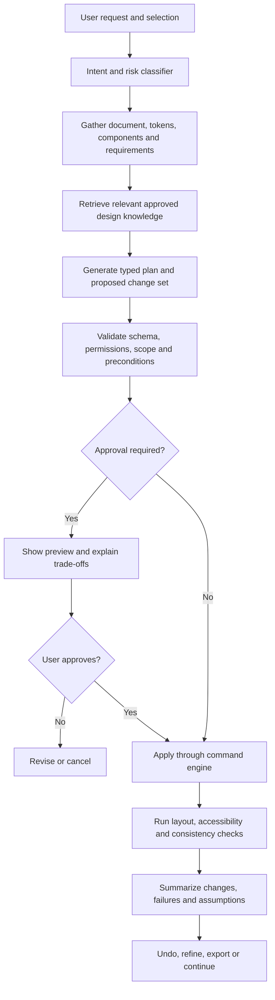

# DesignForge AI — Master Product, AI Agent, and Engineering Blueprint

**Version:** 1.0  
**Prepared:** 27 October 2026  
**Status:** Product strategy and implementation blueprint  
**Purpose:** Define a designer-first, AI-native design platform combining the core capability categories of Figma, Sketch, and Adobe XD, with one editable design engine, an AI design agent, interactive prototyping, device testing, exports, and IDE-ready code delivery.

> **Positioning:** An AI-native professional design workspace that turns requirements into editable design systems, responsive interfaces, interactive prototypes, accessibility-checked experiences, and verifiable developer handoff—while keeping the designer in control.

---

## 1. Executive decision

Build **one application with one canonical design document model**, rather than three separate feature sets stitched together. The document model is the heart of the platform. Every drawing tool, properties panel, prototype interaction, AI action, export format, and code generator must read and write that same model.

The platform should have five mutually reinforcing pillars:

1. **A professional design engine** with vector, layout, typography, image, component, variable, and design-system capabilities.
2. **A native AI Design Agent** that can understand product intent, use the design system, create and revise editable design objects, explain decisions, validate results, and undo its own changes.
3. **An interaction/prototype engine** for screen flows, component states, variables, conditional logic, transitions, overlays, scrolling, and touch/keyboard interactions.
4. **A design-to-development pipeline** that exports high-quality files and generates a complete React/TypeScript project from the same design document.
5. **A collaboration and testing layer** for reviews, comments, version history, shared sessions, QR-based mobile preview, and real-device feedback.

### The most important product rule

**AI must create real, editable design structures—not just a flat image.** A generated screen should contain understandable layers, components, text, design tokens, layout rules, responsive behavior, and prototype connections wherever the task calls for them.

### What “combine Figma, Sketch, and Adobe XD” means

It means covering their useful *capability categories and workflows* through an original implementation. It does **not** mean copying their source code, proprietary file internals, trade dress, or exact interface. Treat import/export compatibility as an engineering project with its own tests, legal review, and supported-format matrix.

### What to build first

Build an excellent, reliable **core design editor + canonical document schema + undoable command engine + a small set of deterministic AI tools** before attempting advanced effects, full multi-user co-editing, or a proprietary foundation model. The core editor is the dependency for every future capability.

---

## 2. Product principles

### 2.1 Designer-first, AI-assisted

- The canvas and design tools remain usable without AI.
- AI is accessible from a persistent, contextual side panel and command palette; it does not take over the full screen.
- Every AI operation shows intent, proposed changes, and a preview/diff when meaningful.
- Small, low-risk actions can be applied with one click; broad or destructive actions require explicit approval.
- Every AI change is an ordinary editable document transaction and supports undo/redo.
- The user can edit, reject, regenerate, branch, or compare AI alternatives.
- AI should explain *what changed and why*, identify the rules it used, and state any assumptions or limitations.

### 2.2 Design systems are first-class

- Tokens, styles, variables, component libraries, component properties, variants, and responsive rules are native document entities.
- If a matching component or token exists, the agent should reuse it before creating a new one.
- When no match exists, the app may create a new asset, but must mark it as **“New / not in the connected design system”** and show the reason.
- Tokens need semantic meaning (such as `text.primary`, `surface.canvas`, `space.16`, and `radius.card`) as well as raw values.
- Import/export should support the Design Tokens Community Group (DTCG) format where applicable, including alias/reference resolution and a versioned compatibility layer.

### 2.3 Predictable core; probabilistic AI

Use the language model to interpret intent, plan, produce alternatives, and explain. Use deterministic code for geometry, layout, contrast, file parsing, permission checks, document updates, and code export wherever possible.

### 2.4 Progressive complexity

The first-run experience should feel approachable, while the engine supports advanced workflows. Reveal advanced controls contextually instead of forcing every user to navigate hundreds of options on day one.

### 2.5 Evidence and accountability

- Accessibility checks should cite the applicable rule and show the exact affected layers.
- AI-generated research insights should distinguish observations, assumptions, and hypotheses.
- The product must never claim that a generated design is usable, compliant, or validated with users merely because it passed automated checks.
- Distinguish a rule that was **checked**, a rule that **passed**, one that **failed**, and one that was **not checked**.

---

## 3. Users and principal workflows

### Primary users

- UX/UI and product designers
- Design-system designers and design-operations teams
- UX researchers and product managers
- Front-end developers
- Freelancers, students, and small product teams
- Enterprise teams with permissions, audit, and governance requirements

### Core workflow

1. **Brief:** The user describes the product, target users, platform, business goal, constraints, and design-system context.
2. **Clarify:** The AI identifies critical gaps and asks only questions that meaningfully affect the result; it can proceed with clearly labelled assumptions.
3. **Plan:** It proposes a screen inventory, key flows, components, responsive breakpoints, accessibility targets, and deliverables.
4. **Generate:** It creates low-fidelity wireframes or higher-fidelity screens as editable document nodes.
5. **Validate:** Deterministic validators check layout bounds, missing tokens, contrast, text roles, responsive behavior, component consistency, and prototype links.
6. **Iterate:** The user selects an element, section, screen, flow, or full document and asks for a targeted revision.
7. **Prototype:** The system connects screens and states, runs interactions, and publishes a preview.
8. **Test:** The designer scans a QR code on a phone, tests a flow, records observations with consent, and comments on the relevant screen.
9. **Handoff:** The designer exports assets/specifications or generates a React project and runs a build check.
10. **Maintain:** Token, component, and document changes are versioned; downstream generated code can be regenerated or compared.

---

## 4. Product capability inventory

The following is the intended capability universe. It is **not** a statement that every item must ship in the first release.

### 4.1 Canvas and workspace

- Infinite canvas with pan, zoom, zoom-to-selection, zoom-to-fit, minimap, viewport presets, rulers, guides, grids, and snapping.
- Selection, multi-select, marquee selection, range selection, nested selection, select-through, isolate, group, ungroup, frame, section, lock, hide, duplicate, rename, delete, reorder, and align/distribute.
- Contextual quick actions, command search, keyboard shortcuts, customizable shortcuts, tooltips, onboarding, and searchable help.
- Pages and sections; document outline; reusable assets/library panel; design, prototype, accessibility, and inspect modes.
- Canvas themes and presentation/preview modes, independent of the exported artboard background.
- Clipboard operations, local clipboard fallback where browser permissions limit cross-app access, and safe paste handling.
- Autosave, explicit save/export, recovery after refresh or lost connection, file status, and local/offline state.
- Command history, undo/redo, named checkpoints, branching/duplicate exploration, and version comparison.
- Multi-selection property editing with explicit mixed-value indicators.
- Zoom-aware hit testing and selection handles; snapping should not cause jitter during transforms.

### 4.2 Shape, vector, and geometry tools

- Rectangle, rounded rectangle, ellipse, line, arrow, polygon, star, arc, and freehand/pencil tools.
- Pen tool, Bézier paths, anchor-point editing, handle editing, path closure, join/split, contour operations, path simplification, stroke expansion, and vector network support where feasible.
- Boolean operations: union, subtract, intersect, exclude; non-destructive operations should remain editable until intentionally flattened.
- Masks: clipping, alpha masks, vector masks, nested masks, and clear controls for mask boundaries.
- Transform controls: X/Y, width/height, rotation, flip, scale, origin, constraints, aspect-ratio lock, and precise numeric input.
- Fill types: solid, gradient (linear, radial, angular/conic, diamond where supported), image fill, opacity, and multiple fills.
- Stroke: color, width, alignment, cap, join, dash, arrowheads, and multiple strokes where the renderer supports reliable output.
- Effects: shadows, blur, layer/background blur, and blend modes; every effect needs a defined export fallback when a target format cannot represent it.
- Pixel preview and export scaling for raster assets.
- Image placement, crop, focal point, fit/fill, masks, opacity, and non-destructive transforms. Do not promise full photo-editing parity with a dedicated image editor.

### 4.3 Typography

- Text creation, inline editing, selection ranges, line breaks, alignment, letter spacing, line height, paragraph spacing, list support, text boxes, and auto-size modes.
- Font family, weight, variable font axes where supported, size, color, decoration, case transformations, and text styles.
- Font loading states and fallback notices; embedded fonts in exports only when licensing permits.
- Paragraph, character, and mixed-range styling; rich text must be represented in the document schema rather than flattened into one string.
- Text roles: display, heading, body, label, caption, helper, button, and data/table text.
- Responsive type scales; min/max font sizes; fluid type; breakpoint-specific typography; line-length and wrapping checks.
- Overflow detection, clipping warnings, missing-font warnings, truncation rules, and localization expansion checks.
- Text contrast validation against the actual rendered background, including alpha/transparency handling.
- AI typography suggestions should return options with rationale, accessibility checks, token alignment, responsive behavior, and the token/value that will be applied—not just a font-size number.

### 4.4 Layout engine

Support a clear model of layout intent:

- Absolute positioning for freeform compositions.
- Horizontal and vertical stack/auto layout with padding, gap, alignment, distribution, wrap, reverse order, and child sizing.
- Grid layout with columns, rows, gutters, named areas when supported, and responsive behavior.
- Sizing modes equivalent to fixed, hug-content, and fill-container, plus minimum and maximum size.
- Constraints and anchoring for left/right/top/bottom/center and scale behavior.
- Nested layouts; intrinsic text measurement; image aspect-ratio preservation; clipping and overflow behavior.
- Responsive breakpoints and device-specific overrides where genuinely needed; prefer fluid rules over unnecessary breakpoint duplication.
- Layout diagnostics: overflow, clipped descendants, impossible constraints, overlapping interactive targets, unexplained fixed sizes, and breakpoint-specific regressions.
- Deterministic measurement and layout output. The model may propose layout settings, but it must not invent computed positions without validation by the layout engine.

**Implementation rule:** Maintain an independent layout contract. Map supported layout primitives to CSS Flexbox/Grid in the React exporter and test for rendered equivalence. Never assume the visual editor's internal layout matches browser CSS automatically.

### 4.5 Components, styles, variables, and libraries

- Main components, instances, nested components, component properties, boolean/text/instance-swap properties, and variant sets.
- Instance overrides with explicit reset/revert-to-main behavior.
- Detach only with warning and an option to preserve a link to the original component in audit metadata.
- Shared libraries, publishing/versioning, update review, dependency tracking, library permissions, and team-level governance.
- Variables for color, number, string, boolean, and supported composite values; collections, modes, alias/reference resolution, and light/dark/high-contrast themes.
- Semantic tokens and primitive tokens; token descriptions, source, owner, status, deprecation, and contrast metadata.
- Import/export of token files in a version-aware DTCG-compatible format. Preserve unknown fields during round trips when safe.
- Component usage audits, orphan-token detection, duplicate-token recommendations, and component coverage reports.
- AI component generation should be based on the real component API and should not create visually similar but structurally incompatible duplicates without asking.

### 4.6 Design-system automation

- Detect repeated structures and recommend component candidates with a confidence explanation.
- Propose token names and semantic roles from existing conventions; never silently rename established tokens.
- Generate light/dark or high-contrast modes from explicitly supplied rules; report values needing human judgement.
- Detect near-duplicate components, inconsistent spacing, irregular type scales, inconsistent corner radii, and hard-coded values that could use tokens.
- Component documentation generator with intended use, states, variants, anatomy, accessibility, and implementation notes.
- Compare a screen against the connected design system and show differences before applying fixes.
- Batch operations need a dry-run summary, affected-node count, preview, and one undoable transaction.

### 4.7 Prototyping and interaction engine

Represent a prototype as a **graph of screens, interaction hotspots, events, actions, transitions, and state**.

- Screen/frame connections and flow starting points.
- Triggers: click, tap, hover, press, drag/swipe, key press, and timed trigger.
- Actions: navigate, back, open/close overlay, scroll to, set/modify variable, show/hide, change component state, open URL, focus, and reset state.
- Transitions: instant, dissolve/fade, push/slide, move, smart/matched-layer animation, and custom motion where feasible.
- Duration, easing, direction, spring-like presets, reduced-motion settings, and interruption behavior.
- Variables and conditional branches; evaluate expressions in a controlled, typed expression engine rather than arbitrary JavaScript.
- Interactive components, component state machines, nested overlays, scrolling containers, drag handles, forms, validation states, and loading/empty/error states.
- Prototype preview with device frame, resolution, orientation, safe-area handling, background settings, zoom, restart, and flow selection.
- Playback inspector that can show active route, current variable values, matched animation layers, and invalid transitions.
- Support accessible keyboard and focus behavior in previews; do not treat a visually clickable canvas hotspot as sufficient accessibility.
- For v1, prioritize reliable flows and state changes over advanced physics simulations or complete app-runtime emulation.

### 4.8 Collaboration, review, and governance

- Shareable links with granular access: owner, editor, commenter, viewer, inspect-only, and external guest.
- Comments anchored to document nodes, text ranges, coordinates, flows, or prototype sessions.
- Mentions, reactions, resolved threads, review requests, handoff checklists, and notification preferences.
- Presence, live cursors, selections, user colors, active page, and AI-agent activity labels.
- Conflict-safe real-time document edits and offline recovery; keep ephemeral presence separate from permanent document data.
- Version history, named releases, diffs, revert/restore, audit history, and links from a code export to the design version that produced it.
- Team workspaces, organization policies, domains, roles, SSO/SCIM as a later enterprise stage, and admin export/audit controls.

### 4.9 Inspect and developer handoff

- Dimensions, spacing, constraints, layout properties, typography, fills, strokes, effects, tokens, component ancestry, and responsive rules.
- Generated CSS values and semantic token names; never only present raw pixel values where a token is applied.
- Asset export configuration for format, scale, suffix, naming, color profile, and transparency.
- Inspect overlays for baseline, box model, responsive breakpoints, overflow, and component states.
- Design-to-code mapping and a clear list of unsupported or manually implemented behaviors.
- Developer notes, implementation annotations, assets, font metadata, component contracts, accessibility notes, and prototype flow map.
- Code generation should link each output component to original document node IDs so that changes can be tracked.

### 4.10 Import, export, and interoperability

**Target export formats**

- Editable native `.dforge`
- PNG, JPG/JPEG, SVG, and PDF
- CSS/custom-property token files, JSON design document, and component/specification reports
- React + TypeScript project (complete directory, not only a code snippet)
- Optionally HTML/CSS-only prototype package, static storybook-like component showcase, and a shareable web preview

**Import targets to consider**

- SVG, PNG, JPEG, WebP, PDF, token JSON, and documented JSON design formats first.
- Sketch, Adobe XD, Figma or other proprietary native formats only when there is a supported API, documented route, lawful conversion route, or tested import adapter. Do not promise lossless import until each format has a tested compatibility matrix.
- Imported unsupported features must be surfaced as conversion warnings, preserved as flattened visual fallback when sensible, and never silently discarded.

### 4.11 Plugin and extension ecosystem

- Start with a typed plugin API and sandboxed extensions, not arbitrary code running with full document and network access.
- Scopes should be explicit: read selection, read document, write document, read tokens, export assets, make network requests, and access user information.
- Permissions requested at install and invoked at runtime; clear publisher, version, risk surface, review state, and revocation control.
- Plugins run against a versioned public API; all document writes are transactions subject to schema validation and undo.
- AI tools and third-party plugins use the same permission and audit framework.
- Ship a narrow initial set of first-party extensions: token import/export, accessibility report, content/data population, icon/asset helper, and React handoff.

---

## 5. Designer-friendly application layout

Use a coherent editor that can reveal more advanced controls without changing the mental model.

### 5.1 Main editor anatomy

**Top bar**
- Workspace/file name, save/sync status, undo/redo, zoom, share, version history, publish preview, export, and profile/team controls.
- A command/search input that can find tools, layers, components, tokens, actions, and AI commands.

**Left sidebar**
- Tabs: Pages, Layers, Assets, and Libraries.
- A tree with clear nesting and visible component/instance indicators.
- Expand/collapse, hide/lock, search, filters, and quick rename.
- Pages and sections organize work; frames and groups organize actual design structure.

**Canvas**
- Infinite workspace with selection overlays, vector editing, rulers, grids, guides, snapping, comments, prototype wires, and live participant presence.
- Distinct tool modes for selection, frames, shapes, vectors, text, connectors/comments, and hand/pan.
- The canvas should not lose selection or keyboard focus when side panels update.

**Right inspector**
- Contextual tabs: **Design**, **Prototype**, **Accessibility**, and **Inspect**.
- Design shows only relevant sections for the selected entity: geometry, layout, constraints, fills, strokes, effects, typography, variables, component properties, export settings.
- Prototype appears for interaction-enabled nodes and provides triggers/actions/transitions.
- Accessibility identifies contrast, text role, focus, touch-target, and semantic issues.
- Inspect exposes handoff metadata and generated-code mapping.

**AI side panel**
- Input for natural-language requests, image/screenshot attachments where supported, and current selection/document context.
- Tabs: Ask, Plan, Variations, Issues, and History.
- A plan/diff preview for structural changes, with actions: Apply, Edit plan, Apply selected changes, Reject, and Undo.
- Show active context, design-system sources used, model/provider status when appropriate, and validation results.
- The AI panel must not obscure the canvas irreversibly; allow collapse, resize, and keyboard navigation.

**Bottom contextual bar**
- Zoom and coordinate readout, selected objects, layout/constraint warnings, prototype playback status, export status, and sync state as relevant.
- Keep persistent status messages distinguishable from temporary notifications.

### 5.2 Interaction design rules

- Keyboard-first workflows for frequent operations; every drag interaction should have a non-drag alternative where applicable.
- Accessible names and focus states for tool icons, panels, shortcuts, menus, and canvas tree actions.
- Clear distinction between frame, group, section, component, component instance, and prototype flow.
- Property values should update in both the canvas and tree without losing the user's current editing context.
- Avoid modal dialogs for frequent property edits; use inline controls, popovers, and inspectors.
- AI operations should behave like normal editor actions: visible progress, cancellable work, a transaction boundary, and a clear outcome.

---

## 6. Technical architecture

### 6.1 Recommended starting stack

| Layer | Recommendation | Why |
|---|---|---|
| Editor UI | React + TypeScript + Vite | Fast iteration, ecosystem maturity, static deployment, clear typing |
| State | Zustand or Redux Toolkit for UI state; TanStack Query for remote data | Separate ephemeral UI state from server data |
| Scene/document model | Custom typed scene graph and JSON schema | One source of truth for editing, AI, prototypes, and exports |
| Render engine | Renderer abstraction: Canvas/WebGL2 initially; evaluate a retained-mode GPU renderer; optional WebGPU later | Performance without tying document semantics to one renderer |
| Editable text | DOM-based editor overlay aligned to rendered text bounds | Better text input, selection, clipboard, and assistive-technology support |
| Geometry | Typed vector paths plus dedicated geometry/boolean-operation module | Precise editing and export fidelity |
| Layout | Independent constraint/stack/grid engine with browser-CSS mapping tests | Prevent divergence between visual editor and web output |
| Document local cache | IndexedDB | Autosave, asset cache, and offline draft recovery |
| API | TypeScript service layer; Netlify Functions can host lightweight API endpoints initially | Deploy frontend and request handlers together |
| Database/auth/storage | Supabase/Postgres/Auth/Storage as an accessible starting option | Structured data, identity, asset storage, policy-based access |
| Live collaboration | Adapter interface over Yjs or a managed service such as Liveblocks; Supabase Realtime can handle suitable presence/broadcast uses | Lets the product evolve without coupling its schema to a provider |
| AI orchestration | Server-side model-provider adapter + typed tool registry + schema validation + evaluation/observability | Provider flexibility and controlled actions |
| Background jobs | Queue/worker or managed background jobs for large exports, imports, and indexing | Avoid long synchronous browser requests |
| Code output | Deterministic AST/template exporter, then formatting and build/test validation | More repeatable than asking an LLM to invent every source file |
| Desktop later | Tauri or Electron shell after the web editor is validated | Reuse core code and offer native file/device workflows |

This is a starting architecture, not a mandate to adopt every service on day one. Keep abstractions at clear system boundaries, not for the sake of abstracting everything.

### 6.2 Canvas/rendering architecture

Use a **hybrid rendering model**:

- The canonical document is a structured scene graph, not the rendered canvas bitmap.
- A renderer reads scene graph state and draws the current viewport.
- Hit testing, bounds, selection, snapping, and geometry operate on model-space coordinates.
- A DOM overlay handles editable text, keyboard-accessible object selection, inspector focus, and other controls that benefit from semantic HTML.
- Exporters traverse the same scene graph directly rather than screenshotting the canvas.

Do not make WebGPU a requirement for the first release. It can provide useful performance benefits, but browser support is not universal enough to be the only rendering path. Create a renderer interface and maintain a tested Canvas/WebGL fallback. The browser Canvas API also does not expose drawn object semantics to assistive technologies, so the editor must provide accessible tree/inspector equivalents rather than treating the canvas itself as the only interface.

### 6.3 Core software modules

```text
apps/
  editor-web/
  prototype-player/
  admin-console/               # later
packages/
  document-schema/
  scene-graph/
  command-engine/
  geometry/
  layout-engine/
  renderer-core/
  renderer-canvas/
  renderer-webgl/
  text-engine/
  design-system/
  prototype-runtime/
  accessibility-engine/
  export-pdf/
  export-image/
  export-svg/
  export-react/
  dforge-container/
  ai-contracts/
  ai-tool-registry/
  ai-evaluation/
  plugin-sdk/
services/
  api/
  ai-orchestrator/
  export-worker/
  import-worker/
  retrieval-indexer/
  collaboration-adapter/
```

Use a monorepo if it helps the team share types and keep document schema changes coordinated. The editor should depend on interfaces for rendering, persistence, collaboration, and model providers—not provider-specific implementation details.

### 6.4 The canonical document model

All layers in the product should operate on a versioned document graph.

Core entities:

- `Document`
- `Page`
- `Section`
- `Node` (abstract, with a typed node subtype)
- `Frame`
- `Group`
- `Shape`
- `VectorPath`
- `Text`
- `Image`
- `ComponentDefinition`
- `ComponentInstance`
- `VariantSet`
- `DesignToken`
- `VariableCollection`
- `PrototypeFlow`
- `PrototypeInteraction`
- `CommentThread`
- `DocumentRevision`
- `ExportJob`
- `AIChangeSet`

Every node needs a stable ID, parent ID, ordering key, typed properties, visibility/lock state, transform or layout properties, token references, and optional metadata. Avoid relying on array position as a node's identity.

**Illustrative schema:**

```json
{
  "format": "dforge",
  "schemaVersion": 1,
  "document": {
    "id": "doc_01",
    "name": "Checkout redesign",
    "pages": [
      {
        "id": "page_main",
        "name": "Main flow",
        "children": [
          {
            "id": "frame_checkout",
            "type": "frame",
            "name": "Checkout",
            "layout": {
              "mode": "stack",
              "direction": "vertical",
              "gap": 16,
              "padding": [24, 24, 24, 24],
              "align": "stretch"
            },
            "style": {
              "fill": { "token": "color.surface.canvas" }
            },
            "children": []
          }
        ]
      }
    ],
    "tokenCollections": [],
    "prototypeFlows": [],
    "assetManifest": []
  }
}
```

This is only an illustrative schema. Define a formal JSON Schema (and TypeScript types generated from it or vice versa) before production. Define migration functions for every breaking schema change.

### 6.5 Command engine, history, and AI edits

Every editing action should be represented as a typed command. The command engine validates preconditions, applies the mutation, creates history data, and triggers re-render and persistence.

Examples:

- `CreateNode`
- `DeleteNodes`
- `MoveNodes`
- `ResizeNode`
- `SetNodeProperty`
- `ReparentNodes`
- `CreateComponent`
- `BindToken`
- `SetLayoutProperties`
- `ConnectPrototype`
- `UpdatePrototypeVariable`
- `ApplyStyleBatch`

A command should contain:
- command ID and schema version
- target document and stable node IDs
- expected document revision or precondition
- validated operation payload
- actor/source (user, import, AI, plugin)
- affected nodes
- undo/reverse data or a reversible operation
- postconditions and validation results

**AI writes are commands too.** The AI does not receive unrestricted direct database mutation privileges. The server checks actor permissions, schema validity, node ownership and existence, quotas, and document revision before applying a change set.

### 6.6 `.dforge` native project container

Use `.dforge` as a versioned, portable project container. A practical initial design is a ZIP-compatible archive that holds:

```text
project.dforge
  manifest.json
  document.json
  design-system/
    tokens.json
    components.json
  prototype/
    flows.json
  assets/
    asset_<hash>.png
    asset_<hash>.svg
  previews/
    document-preview.png
  metadata/
    export-history.json        # optional
```

**Manifest responsibilities**
- File format version and document schema version
- Document ID/name and creation/update metadata
- Asset references, MIME types, and hashes
- Required feature flags and compatibility notes
- Optional application version and migration notes

Rules:
- Never package API keys, auth tokens, session cookies, or secret environment variables in `.dforge`.
- Hash assets for deduplication and integrity checks.
- Treat imports as untrusted inputs: impose size, decompression, node-count, nesting-depth, and image-decoding limits.
- A missing asset should produce a visible error and a repair action, not silently substitute the wrong image.
- Maintain round-trip tests: load → save → load should preserve supported document meaning and identifiers.
- Keep cloud collaboration revision history in the service; the local bundle should be portable rather than a complete database dump.

---

## 7. AI Design Agent architecture

### 7.1 Agent mission

The agent should behave as a reliable design collaborator: it understands the user’s goal and current document, proposes a bounded plan, performs permitted operations through tools, validates the resulting design, and explains what changed.

It should not be a general chatbot bolted onto a canvas. It must be a **tool-using, context-aware, schema-constrained product agent**.

### 7.2 Agent pipeline



### 7.3 Context supplied to the agent

Use the minimum context relevant to the task:

1. The user's explicit request and chosen constraints.
2. Selection details or relevant pages/flows, not automatically the entire workspace.
3. Document node summaries and exact schema for tools it may use.
4. Connected design-system tokens/components and their usage rules.
5. Existing app/platform constraints and desired output targets.
6. Accessibility rules, product conventions, and approved project documentation.
7. Results from deterministic validators and test fixtures.
8. User-approved assumptions and previous actions relevant to the current task.

Context must respect access control. Never retrieve another team's private design-system library or file because its embedding is semantically similar.

### 7.4 Agent tool registry

Expose a small typed tool set first:

**Read-only tools**
- `get_document_summary`
- `inspect_selection`
- `get_layer_tree`
- `get_layout_properties`
- `search_components`
- `get_design_tokens`
- `get_prototype_graph`
- `get_export_capabilities`
- `run_accessibility_audit`
- `run_responsive_checks`
- `search_approved_knowledge`

**Write tools**
- `create_frame`
- `create_shape`
- `create_text`
- `create_vector_path`
- `set_node_properties`
- `apply_layout`
- `bind_design_token`
- `create_component`
- `create_component_variants`
- `create_prototype_interaction`
- `create_prototype_flow`
- `apply_change_set`

**Delivery tools**
- `export_asset`
- `generate_react_project`
- `validate_generated_project`
- `publish_mobile_preview`
- `create_handoff_report`

Every tool must specify a typed input, typed output, authorized scopes, allowed side effects, timeout, maximum operation count, idempotency behavior, and validation contract. Do not expose generic `execute_code`, unrestricted database access, or arbitrary shell access to the agent.

### 7.5 Structured generation contract

An AI-generated plan should follow a JSON Schema validated by the application. For example:

```json
{
  "goal": "Create a mobile checkout wireframe",
  "assumptions": [
    "Mobile-first layout",
    "Existing typography and color tokens should be reused"
  ],
  "target": {
    "pageId": "page_main",
    "frameIds": []
  },
  "operations": [
    {
      "tool": "create_frame",
      "reason": "Establish the target viewport",
      "input": {
        "name": "Checkout",
        "width": 390,
        "height": 844
      }
    }
  ],
  "checks": [
    "No horizontal overflow",
    "Use existing tokens where a semantic match exists",
    "All required form controls have labels"
  ],
  "risks": [],
  "confidence": "medium"
}
```

The example is illustrative. In production, the schema should use discriminated unions per tool, validated IDs, strict enumerations, bounded strings/numbers, and explicit error states. The app must reject invalid tools and unsupported properties. Schema validity is necessary but does not prove design quality.

### 7.6 Hallucination-resistant design behavior

1. **Inspect before acting.** Read the real selection, document schema, tokens, components, and viewport.
2. **Search before creating.** Look for matching design-system assets before inventing new ones.
3. **Plan before bulk edits.** Return the target scope, expected node count, important assumptions, and actions.
4. **Use real tools.** Do not claim a component, token, prototype, or export exists unless a tool confirms it.
5. **Validate deterministic facts.** Geometry, contrast, missing assets, layout bounds, color parsing, and file existence are checked in code.
6. **Use diff-based changes.** Show the affected objects and permit partial approval.
7. **Separate observation from inference.** Example: “The selected text has a contrast ratio of 3.1:1” is a check result; “this may be hard to read for some users” is an interpretation.
8. **Cite knowledge.** When an explanation relies on retrieved standards or approved documentation, link to the exact source and, when available, its section.
9. **State uncertainty.** If no appropriate component exists, a requirement is ambiguous, or the output target is unsupported, say so rather than guessing.
10. **Verify the result.** Re-read the affected nodes and run postcondition checks after an operation.
11. **Keep actions reversible.** Apply a coherent set as one transaction with undo.
12. **Use feedback correctly.** User ratings and edits can inform evaluation and training only under appropriate consent, privacy rules, and data-use policy.

### 7.7 Specialist capabilities

Start as a single orchestrator routing to small task specialists or tightly scoped prompts. Avoid a swarm of agents for every request.

| Specialist | Job | Deterministic companion checks |
|---|---|---|
| Requirements analyst | Clarifies goal, users, platform, flows, acceptance criteria | Missing requirements checklist |
| UX flow planner | Screen inventory, journey, decision points, empty/error/loading states | Graph completeness and unreachable screens |
| Design-system analyst | Finds tokens/components; proposes reusable patterns | Token/component existence checks |
| Layout designer | Creates structure and responsive rules | Layout engine and overflow checks |
| Visual designer | Proposes hierarchy, visual direction, type and color options | Contrast, token, type and spacing checks |
| UX writer | Labels, helper text, errors, inclusive content, terminology | Length, missing labels and content lint |
| Accessibility auditor | Explains and prioritizes accessibility issues | Rule-specific validators |
| Prototype engineer | Wires interactions and states | Broken links, missing targets, state coverage |
| Code/handoff engineer | Maps nodes to components, generates specs and code | Type check, lint, build, screenshot comparison |
| Critic/verifier | Reviews outcomes against explicit acceptance criteria | Independent deterministic test suite |

The verifier should assess the generated output against requirements; it should not be treated as an infallible second model. High-risk operations still require deterministic controls or user approval.

### 7.8 Design generation workflow

For “Create a dashboard” or “Generate a mobile app flow,” the agent should produce these stages:

1. **Brief object:** task, target users, platform, goals, requirements, exclusions, assumptions.
2. **Flow model:** screen IDs, user goals, actions, transitions, error/empty/loading states.
3. **Design plan:** visual direction, layout approach, tokens, components, breakpoints, accessibility constraints.
4. **Generation plan:** typed operations with stable IDs and intended parent/child structure.
5. **Editor transaction:** create editable nodes and references.
6. **Validation pass:** layout, tokens, contrast, typography, missing states, prototype reachability, responsive viewports.
7. **Revision proposals:** discrete issues with targeted fixes.
8. **Explanation:** summarize applied changes, unresolved issues, assumptions, and useful next actions.

### 7.9 AI memory and retrieval

Use three separate layers; do not mix them into one unbounded chat history:

- **Session context:** current task and recent interactions.
- **Project memory:** explicit project requirements, approved decisions, component conventions, and user-confirmed preferences. Version and allow review/deletion.
- **Knowledge retrieval (RAG):** approved product documentation, design-system docs, standards, internal playbooks, and user-authorized sources.

Chunk and index documents with source metadata, access-control labels, document version, section/page, timestamp, license/rights status, and freshness. Use hybrid lexical + semantic retrieval and reranking where it measurably improves relevance. Show source attribution for facts. Add retrieval tests and permission leakage tests.

Do not bundle copyrighted books into a commercial product knowledge base, model training set, or customer-facing search feature without rights. Prefer licensed content, public standards, user-owned docs, and organization-approved material.

---

## 8. Building the “AI model” strategically

### 8.1 Do not start by training a foundation model from scratch

For this application, the first competitive advantage is the **design-specific system around existing models**:

- Good document/context representation
- Reliable tool calls
- Carefully designed prompts and structured outputs
- Access-controlled retrieval
- Deterministic layout/accessibility/render validation
- A high-quality evaluation dataset
- A useful feedback loop
- Efficient model selection per task

Training a large base LLM from scratch is expensive and unnecessary for validating the product. Build the application first, measure task failures, then decide whether a small fine-tuned specialist model is worth the effort.

### 8.2 Model-provider abstraction

Create a provider interface with capabilities rather than coding directly against one vendor.

Capabilities to declare:
- Text reasoning and tool calling
- Structured JSON/schema outputs
- Image/screenshot understanding
- Long-context handling
- Streaming
- Embeddings
- Fine-tuning/adapter support
- Data retention and training policy
- Latency, price, region, and rate limits

A router selects a model based on task type, quality score, privacy requirement, latency budget, and available quota. A cheaper model can handle extraction or simple edits; a stronger model can plan complex multi-screen flows or critique a design. Always permit a configurable fallback.

### 8.3 Model training roadmap

**Stage A — No training**
- Use existing model APIs or hosted open-weight inference.
- Build typed tools, retrieval, prompts, postconditions, and evaluation.
- Establish a human-reviewed benchmark set.

**Stage B — Small specialized models**
- Train or fine-tune a classifier for task routing, component categorization, text-role classification, layout issue categories, or design-system candidate matching if the data and task justify it.
- Use human-reviewed examples with documented provenance and consent.

**Stage C — Fine-tune an open-weight model**
Proceed only if benchmark evidence shows repeatable weaknesses in a narrow task (for example structured operation planning or domain-specific UX requirement extraction) that prompt/RAG/tool improvements do not fix.
- Build a deduplicated dataset from rights-cleared examples.
- Use expert-authored and expert-reviewed targets.
- Split train/validation/test by project or source, avoiding leakage.
- Compare base vs fine-tuned quality, safety, latency, and total serving cost.
- Keep rollback and versioned model cards.

**Stage D — Custom pretraining**
Only consider this after substantial product-market evidence, a data-rights program, ML research capability, infrastructure budget, and a concrete reason existing models cannot satisfy the requirements. It is not a prerequisite for a strong AI design product.

### 8.4 Training/evaluation dataset ideas

Create task-specific datasets such as:

- Natural-language brief → requirements/assumptions JSON
- Requirement → screen flow graph
- Existing design-system snapshot + request → valid tool-call plan
- Node selection + text instruction → edit operations
- Component library + screen → component reuse decisions
- Screenshot/layout → element-role hypotheses with uncertainty
- Layout issues → severity, explanation, suggested repair
- Design graph + platform → React component mapping
- Request + retrieved design rules → answer with source references
- Malicious/injected text in a design or imported file → safe refusal/contained behavior

Every sample should include its source, author/reviewer, allowed usage, quality label, and version.

### 8.5 Evaluation framework

Evaluate the **whole system**, not only the language model.

**Task success**
- Requirement coverage
- Correct operation/tool selection
- Schema validity
- Component/token reuse precision
- Prototype graph correctness
- Build success for generated code

**Visual and structural quality**
- Screenshot similarity at target viewports
- Layout consistency and overflow rate
- Type hierarchy and spacing consistency
- Editable structure retained (not flattened)
- Responsive behavior across breakpoint test cases

**Accessibility**
- Contrast calculations
- Missing label/semantic metadata
- Focus order and keyboard behavior
- Target-size and focus visibility checks
- Reduced-motion behavior
- Automated rule pass rate and false-positive rate

**Reliability**
- Invalid tool arguments
- Unsupported claims
- Failed postconditions
- Undo/replay correctness
- Document corruption rate
- Permission violations and retrieval leakage

**UX and business**
- Time to first useful draft
- Acceptance rate of suggested changes
- Undo/reject/regenerate rates
- Time saved on repetitive tasks
- Number of manual fixes after generation
- Successful mobile test sessions
- Handoff defects discovered after code generation

**Operations**
- First-token latency and end-to-end latency
- Model/embedding/worker cost per accepted task
- Cost per validated output
- Error and retry rates
- Queue depth and failure recovery

Run regression evaluations whenever a model, prompt, tool schema, layout engine, token parser, or exporter changes. Maintain “golden projects” as fixtures for rendering and code parity.

---

## 9. Accessibility and UX quality engine

Accessibility must be both a designer-facing feature and a quality gate. It cannot be a one-click badge claiming full compliance.

### 9.1 Automated checks

- Relative luminance and contrast ratio for text and meaningful non-text controls.
- Text role and font-size classification, with user override where classification is ambiguous.
- Text clipping, low line height, very long lines, and responsive overflow.
- Keyboard accessibility metadata and focus visibility for prototype/runtime components.
- Missing accessible names, form labels, headings, control states, alternative text, and link context in generated web output.
- Touch target checks and spacing warnings.
- Use of color alone to communicate status; provide an additional visual cue.
- Reduced-motion alternatives for animation.
- Contrast/focus checks in all defined modes (light/dark/high contrast) and relevant background states.

For WCAG 2.2 AA-oriented text contrast checks, use a minimum ratio of **4.5:1 for normal text** and **3:1 for large text**, with the specification's stated exceptions. Treat non-text components and focus states under their own criteria. Do not generalize the text thresholds to every UI element.

### 9.2 AI-generated typography recommendation contract

A recommendation should include:
- Role classification and confidence
- Existing style/token candidates
- Font-family, size, weight, line-height, tracking, and responsive scale
- Expected line wrapping and overflow at each target viewport
- Contrast ratio and tested foreground/background pair
- Font availability/fallback notes
- Token compatibility
- Why the option was chosen
- Alternative options and trade-offs
- Explicit validation status (pass/fail/not checked)

The engine calculates contrast and layout using code; the model explains and proposes. If it cannot access the actual background or font metrics, it must indicate that the result is provisional.

### 9.3 Human-centred guardrail

Automated validation cannot prove the experience solves the user's problem. Include usability testing, human review, and real-device interaction in the product workflow. AI may help recruit test questions, synthesize consented notes, identify usability hypotheses, and organize findings; it must not fabricate observations or claim to have interviewed users when it has not.

---

## 10. React project generation and IDE handoff

### 10.1 Deterministic exporter, AI-supported interpretation

Use the canonical document graph to generate code with a deterministic renderer/exporter. The LLM can help infer semantic names, propose component boundaries, explain choices, and fix validated compile errors within a sandbox. It should not be the sole mechanism translating geometry and layout into source code.

### 10.2 Project output structure

```text
checkout-redesign/
  package.json
  README.md
  vite.config.ts
  tsconfig.json
  index.html
  src/
    main.tsx
    App.tsx
    routes/
    components/
    screens/
    hooks/
    data/
    styles/
      tokens.css
      global.css
      utilities.css
    prototype/
      flow-map.json
      state.ts
    generated/
      design-map.json
  public/
    assets/
  design/
    source.dforge
    export-report.json
```

- Provide a simple `npm install` / `npm run dev` / `npm run build` workflow.
- Preserve design node IDs in `design-map.json` and optional code comments/metadata for traceability.
- Translate tokens to CSS custom properties and supported modes to data attributes or theme providers.
- Use native semantic HTML elements where possible, not generic `<div>` for every node.
- Map supported stack layouts to flexbox and grid to CSS Grid; emit a warning for unsupported effects/behavior.
- Ensure no credentials or private keys end up in the generated project.
- Include a README documenting framework versions, scripts, assets, fonts, supported interactions, unsupported design semantics, and manual follow-up.
- Treat generated runtime and preview code as untrusted until lint/type-check/build tests pass in an isolated environment.

### 10.3 IDE integration modes

1. **Download project ZIP** — reliable first release.
2. **Export folder** — desktop wrapper can write to a chosen directory with user permission.
3. **Open in IDE** — desktop/deep-link integration where the operating system and IDE allow it.
4. **Git repository integration** — later, using explicit OAuth consent, repository and branch selection, preview diff, commit review, and revocation.
5. **Bidirectional sync** — advanced stage. Define conflict resolution and source-of-truth rules before offering it.

Do not claim that a web page can write arbitrary local files or launch an IDE on every OS without user consent, permissions, and a compatible local bridge.

---

## 11. Mobile live preview and usability testing

### 11.1 First-release design

Build a mobile-friendly **prototype player/PWA**. The designer publishes a short-lived or permission-protected preview URL; the editor renders a QR code. The user scans it on a phone and tests the flow in a real browser.

Capabilities:
- Phone/tablet viewport presets and actual viewport size display
- Touch events, drag/swipe, keyboard-on-device behavior, safe-area handling, scrolling, and orientation
- Session-linked comments and issues
- Live refresh when the designer changes the document
- Flow restart and state reset
- Device/browser metadata with the user's consent
- Optional consent-based recording or event log; redact sensitive fields by default
- Compare device rendering with reference screenshots
- Shareable preview links with expiry and revocation

### 11.2 Network and sync approach

- Use HTTPS and a permissioned preview token.
- Separate the public preview player from editor authorization.
- Stream document/prototype updates with a suitable realtime service; use versioned snapshots and reconnect recovery.
- Do not send the full document on every cursor movement.
- On unstable networks, keep the last valid snapshot and show stale/offline status instead of pretending the preview is live.
- Use IndexedDB for local caching where appropriate; keep PII and session recordings out of persistent local storage unless required and consented.

### 11.3 Native device connection later

A native iOS/Android companion can offer easier mirroring, screenshots, notifications, and instrumented test capture. It is not required to validate the core idea: QR-based browser testing is a lower-cost route to real-device coverage.

---

## 12. API and data model

### 12.1 Core entities

- `users`
- `organizations`
- `organization_members`
- `workspaces`
- `projects`
- `documents`
- `document_revisions`
- `document_assets`
- `design_token_collections`
- `design_tokens`
- `component_libraries`
- `components`
- `prototype_flows`
- `prototype_interactions`
- `comments`
- `ai_runs`
- `ai_changesets`
- `ai_tool_calls`
- `exports`
- `preview_sessions`
- `audit_events`
- `plugin_installs`
- `model_evaluation_runs`

Store the canonical document as versioned JSON/blob data with indexed relational metadata. Avoid making a giant document graph one relational row per tiny property in the first implementation; use a sensible hybrid. Move high-volume events/logs to appropriate storage if product scale requires it.

### 12.2 Suggested document metadata

```text
documents
  id (uuid)
  workspace_id
  name
  owner_id
  schema_version
  head_revision_id
  storage_key
  thumbnail_key
  created_at
  updated_at
  deleted_at
```

```text
document_revisions
  id (uuid)
  document_id
  parent_revision_id
  revision_number
  author_id
  operation_summary
  snapshot_key
  created_at
```

```text
ai_runs
  id (uuid)
  document_id
  user_id
  model_provider
  model_id
  task_type
  status
  input_summary
  output_summary
  validation_report
  latency_ms
  estimated_cost
  created_at
```

Do not store sensitive prompts and entire document snapshots in observability logs by default. Store concise metadata and use consented, access-controlled debugging traces.

### 12.3 Example API surface

**Documents**
- `POST /api/documents`
- `GET /api/documents/:documentId`
- `PATCH /api/documents/:documentId/metadata`
- `POST /api/documents/:documentId/commands`
- `GET /api/documents/:documentId/revisions`
- `POST /api/documents/:documentId/revisions/:revisionId/restore`

**Design system**
- `GET /api/workspaces/:workspaceId/tokens`
- `POST /api/workspaces/:workspaceId/tokens/import`
- `POST /api/workspaces/:workspaceId/tokens/export`
- `GET /api/workspaces/:workspaceId/components/search`

**AI**
- `POST /api/ai/plan`
- `POST /api/ai/changesets`
- `POST /api/ai/changesets/:changeSetId/validate`
- `POST /api/ai/changesets/:changeSetId/apply`
- `POST /api/ai/audits/accessibility`
- `POST /api/ai/audits/responsive`

**Prototype/export**
- `POST /api/documents/:documentId/previews`
- `POST /api/documents/:documentId/exports`
- `GET /api/exports/:exportId`
- `POST /api/documents/:documentId/code-projects`
- `GET /api/code-projects/:projectId/download`

Use explicit status types (`queued`, `running`, `succeeded`, `failed`, `cancelled`), idempotency keys on retryable writes, request-size limits, strict validation, and rate limiting. Endpoint names are proposed conventions, not an existing implementation.

### 12.4 Security and authorization

- Use server-side authorization on every document, token, asset, export, and tool call.
- Verify organization/workspace membership; do not trust client-provided `userId`, `ownerId`, or `role`.
- Enforce row-level access controls where supported, and separately test object-storage permissions and signed URL expiry.
- Check a signed preview token against document scope and expiration.
- Keep model API credentials server-side.
- Limit tool calls by user/workspace quota, operation count, runtime, file size, and model output.
- Audit permission changes, exports, public sharing, administrative actions, and applied AI changes.
- Provide a clear data retention and deletion policy for user documents, embeddings, logs, recordings, and backups.

---

## 13. Backend and deployment strategy

### 13.1 A practical low-cost path

**First stage**
- Deploy the static React editor to Netlify or another static host.
- Use server-side functions as a thin API/proxy for model requests and lightweight business operations.
- Use Supabase (or an equivalent Postgres/Auth/Object Storage service) for identity, metadata, assets, and basic real-time events.
- Keep core editor state local-first so users can create and edit without a server round-trip for every keystroke.
- Provide one configurable AI provider and an honest graceful fallback when model quota is unavailable.

**Next stage**
- Add a managed collaboration provider or a separately hosted WebSocket/CRDT service for persistent shared editing, presence, and conflict-free operations.
- Add an export/import worker and job queue for larger files and project builds.
- Add observability, AI evaluations, usage quotas, rate limits, and abuse prevention.

**Later**
- Private-cloud or enterprise deployment options, organization-scoped retrieval indexes, SSO, advanced audit exports, and optional self-hosted inference for users who require it.

### 13.2 Important hosting boundary

Static hosting plus serverless functions is suitable for the web UI and many API requests. It should not be treated as a general-purpose persistent collaborative server. Real-time collaboration needs a suitable WebSocket/realtime provider or a separately managed server. Larger tasks such as multi-format exports, archive scanning, model evaluation, and generated-project builds need background job handling and strict limits.

Netlify documents background functions that can run for up to 15 minutes, but these are asynchronous tasks and do not provide the same response-streaming or persistent-session semantics as a dedicated realtime service. Choose the hosting technology for the workload, not because one service is already hosting the frontend.

### 13.3 Resilience

- Save locally and display sync status.
- Use retry with backoff for transient network errors.
- Make export and AI job submission idempotent.
- Store job status and a user-visible error; never leave a spinner running indefinitely.
- Keep feature flags for experimental AI tools.
- Back up document metadata and assets; test restore workflows.
- Monitor cost, latency, failed operations, and document integrity—not just HTTP uptime.

---

## 14. AI safety, privacy, and reliability

The architecture must defend against prompt injection, unsafe tool invocation, data leakage, unreliable outputs, abusive usage, and accidental destructive edits.

### Required controls

1. **Least privilege:** Each tool receives only the permissions needed for its task.
2. **Tool allowlist:** Model-generated tool names never execute unless registered, authorized, and schema-valid.
3. **Approval gates:** Require confirmation for deletion of many nodes, publishing public links, external uploads, token-wide changes, repository writes, or other significant side effects.
4. **Safe imports:** Treat project files, SVGs, images, plugins, and retrieved documents as untrusted. Sanitize active SVG content and isolate preview/render code.
5. **Output validation:** Validate generated schemas and all downstream code/data before use. Valid JSON is not proof that the content is correct or safe.
6. **Code sandbox:** Build and execute generated projects in an isolated worker/container, not inside the editor's trusted app process.
7. **Privacy:** Encrypt data in transit and at rest, apply workspace isolation, redact secrets in logs, and offer deletion/retention controls.
8. **Cost controls:** Per-user and per-workspace quotas; file-size and token limits; model timeouts; queue bounds; cancellation; alerting for abnormal consumption.
9. **Auditability:** Store applied change-set summaries, actor, revision, tools used, validation results, and approval state.
10. **Supply-chain controls:** Pin and scan dependencies, validate plugin publisher and permissions, and version model prompts/tools/evaluation cases.
11. **No unsupported claims:** User-facing summaries must report actual tool results and surface checks that were skipped.
12. **Human oversight:** Designers approve uncertain or high-impact decisions. AI suggestions do not establish usability, compliance, or legal clearance.

Use the current OWASP GenAI / LLM security guidance as a security review checklist and keep it versioned as the guidance changes.

---

## 15. Performance and engineering quality targets

Treat the following as **proposed product targets to test and revise**, not observed benchmarks.

- Common selection, movement, resize, and property edits should feel immediate on a modern supported laptop.
- For ordinary files, keep input-to-canvas feedback responsive and avoid full-document React rerenders per pointer movement.
- Large import/export, image processing, and AI generation should run as cancellable jobs with visible status.
- Cache layout measurements, text metrics, asset decoding, and vector geometry where valid; invalidate caches from document revisions.
- Use incremental scene updates and viewport culling for large canvases.
- Maintain separate performance budgets for document size, node count, raster assets, collaboration messages, AI prompts, and generated code size.
- Support reduced-motion UI, keyboard interaction, high-DPI and zoomed display, and low-bandwidth fallback.
- Set error budgets for autosave, failed loads, failed export, broken prototype links, and generated-project build failures.
- Monitor p50/p95 latency, crash-free editor sessions, dropped collaboration updates, failed postconditions, and cost per accepted AI result.

### Test layers

- Unit tests for geometry, colors, contrast, layout, schema migrations, command reversibility, and prototype state transitions.
- Property-based tests for transforms, serialization round trips, geometry and token reference integrity.
- Golden-file tests for SVG/PDF/image exports.
- Visual regression tests across representative browsers, DPRs, and viewport sizes.
- Cross-browser input and text-editing tests.
- Collaboration race tests and offline/reconnect simulations.
- Accessibility tests for both the editor UI and generated runtime.
- AI evals using known tasks, invalid briefs, adversarial content, ambiguous requests, absent components, and unsupported output requirements.
- End-to-end “design → preview → export React → type check/build” tests.

---

## 16. Release roadmap and dependencies

Build in dependency order. Avoid trying to launch the entire capability inventory at once.

### Phase 0 — Product and engine foundations

Deliver:
- Supported browsers/OS, core user flows, file format, and schema decision records.
- Initial editor interaction prototypes and usability tests with real designers.
- Canonical document schema, migrations, renderer interface, command engine, local autosave, and undo/redo.
- A set of golden design files and acceptance tests.

**Exit gate:** A document can be created, edited, saved, reopened, and rendered consistently without AI.

### Phase 1 — Usable design editor

Deliver:
- Canvas, layers, frames, grouping, shapes, text editing, fills/strokes, transforms, alignment, basic vector paths.
- Layout stack, constraints, basic grid, image handling, component basics, variables/tokens.
- SVG/PNG/JPEG/PDF export with a clear compatibility matrix.
- Native `.dforge` save/load and safe import validation.

**Exit gate:** Designers can complete a small multi-screen UI without needing the AI; export and reload retain supported structure.

### Phase 2 — AI generation and correction

Deliver:
- Provider adapter and secure server-side AI gateway.
- Document-aware assistant, requirements extraction, low-fidelity generation, targeted edits, layer naming, component/token reuse.
- Previewable change sets, undo, deterministic validation, accessibility and responsive audit.
- Evaluations and observability for AI operations.

**Exit gate:** AI can complete a benchmark of design tasks while maintaining editable layers, using actual available tokens/components, and reporting unsupported or failed checks honestly.

### Phase 3 — Prototype and mobile preview

Deliver:
- Prototype graph, triggers/actions, transitions, variables, component states, flow player.
- QR-based phone preview, responsive/device presets, session comments, access-controlled links.
- Prototype validation and basic session test report.

**Exit gate:** A designer can build and test a representative multi-screen flow on a physical phone.

### Phase 4 — Developer handoff and project generation

Deliver:
- Code inspection, semantic node-to-component mapping, deterministic React/TypeScript exporter, CSS token output, project ZIP.
- Isolated type-check/lint/build validation, export warnings, source design map, and README.
- Prototype-to-code support where the design behavior maps to real interactions.

**Exit gate:** A generated reference project compiles and its supported layouts/flows match the source across defined golden test cases.

### Phase 5 — Team collaboration and ecosystem

Deliver:
- Concurrent editing, cursors, comments, roles, version history, library publishing, plugins, and team workflows.
- Managed realtime provider or a production CRDT/WebSocket service.
- Team-level governance and usage analytics.

**Exit gate:** Collaboration recovers safely from simultaneous edits, network interruptions, permission changes, and revision restore.

### Phase 6 — Advanced capability expansion

Candidate capabilities:
- Advanced vector networks and non-destructive geometry operations
- More complex animation/interaction state
- Advanced image manipulation and motion assets
- Broader import adapters and interoperability
- AI-constructed multi-screen products, data-driven prototypes, and more sophisticated usability-analysis assistance
- Enterprise deployment, custom model endpoints, organization-scoped RAG, and advanced governance

Only promote features when there is a tested implementation path, clear user demand, and a measurable quality bar.

---

## 17. Product metrics and market differentiation

### User value metrics

- Time from brief to first editable wireframe
- Time from wireframe to usable interactive prototype
- Percentage of AI changes accepted with minimal edits
- Percentage of generated components that reuse existing tokens/components
- Count of layout/accessibility defects caught before handoff
- Successful test sessions on real mobile devices
- Generated-project build success rate
- Reduction in manual handoff corrections

### Reliability and trust metrics

- Percentage of AI actions with validated postconditions
- Unsupported claims per 100 AI tasks
- Invalid tool calls per 100 runs
- Incorrect or unauthorized tool execution (target: zero)
- Autosave and file-recovery success
- Export round-trip correctness
- Regression rate after schema/model/tool updates
- Percentage of evaluations with source attribution when a factual explanation is required
- Cost per accepted, validated design task

### Differentiation to pursue

1. **AI actions are editable and reversible**, instead of being locked into generated screenshots or blobs.
2. **Design-system-native generation** that reuses existing components and tokens.
3. **Explainable recommendations** with visible assumptions and deterministic checks.
4. **One design graph across canvas, prototype, export, and code.**
5. **Accessible-by-default workflows** with actionable audit results.
6. **Real-device testing built into the creative process.**
7. **Provider choice and cost control**, rather than binding the product's identity to one LLM vendor.
8. **Open and versioned project format** with migration and portability safeguards.

Do not compete on “we have more AI buttons.” Compete on whether the product consistently helps teams make better, testable, editable, and shippable design decisions.

---

## 18. Uploaded-source synthesis

This blueprint combines relevant ideas from the uploaded sources. It is a cross-source synthesis based on document contents, searchable text, tables of contents, and targeted topic review—not a line-by-line scholarly critique of every page. One PDF, *Practical UI* by Adham Dannaway, could not be parsed in this environment (the file returned a zeroed binary header and no extractable pages); it is therefore not treated as reviewed evidence below. Some material is older or partial, and platform features should always be validated against current official documentation.

### 18.1 Design tools and product-design workflow

| Uploaded source | Relevant contribution to the blueprint | Application |
|---|---|---|
| *Designing in Figma* — Eugene Fedorenko (2020) | Shapes, vectors, Boolean groups, masks, fills/strokes/effects, text, exports, frames, constraints, layout grids, rulers/guides, auto layout, pages, components, styles, libraries, version history | Core design-engine inventory and editable document structure |
| *Figma Guide* — /designer, Russian-language guide (2019) | Interface zones, canvas, toolbar, pages/layers, right property panel, frames, shapes, layout and workflow fundamentals | Interaction model and contextual inspector; treat tool-version details as historical |
| *The Complete Figma Guidebook: From Non-Designer to Pro* | Vector/pixel mental models, frame/group/section behavior, path and Boolean operations, auto layout, hug/fill/fixed sizing, tokens, variants, variables, prototype triggers/actions/states | Plain-language onboarding, layout model, component/variable/prototype semantics |
| *Figma for Beginners* — TechMastery Hub (2026) | Interface, canvas, layers, properties, core shapes, wireframes, components, design systems, prototyping, exporting and real-world projects | Beginner-friendly workflows and feature checklist |
| *A Designer’s Guide to Figma* — Daniel Schwarz | Low- and high-fidelity prototyping, collaboration, handoff, accessibility, exports, data synchronization and advanced workflows | End-to-end workflow from ideation to handoff |
| *Design Beyond Limits with Figma* — Simon Jun (uploaded early-access chapters 1–3) | Collaboration, versioning, sharing/permissions, feedback loops, plugin decisions, AI-assisted design tools and ethical concerns | Collaboration architecture, plugin governance and responsible AI workflow |
| *AI in UX Design* — Lise Pilot (2026) | AI as a collaborator; problem definition; understanding users; Jobs to Be Done, UX flows and requirements; shifting prototyping earlier; AI-assisted software development; responsible AI principles | AI should help frame the problem and test hypotheses, not merely stylize screens |
| *Instructional Design Unleashed* — Ankita Jiyani Mangtani (2024) | Human-centred design, UX/HCI, learning theories, agile/AI methods, context and limitations of instructional design | Progressive disclosure, understandable workflows, reducing cognitive load and testing with actual users |

### 18.2 AI foundations and engineering

| Uploaded source | Relevant contribution to the blueprint | Application |
|---|---|---|
| *Artificial Intelligence and Large Language Models: A Scientific Perspective* — Moallem, Degen and Ntoa (2026) | Scientific foundations, human factors/HCI, trust, legality, security, controls, and responsible use | Governance, transparency, human oversight and risk-aware product behavior |
| *Artificial Intelligence and Large Language Models: An Introduction to the Technological Future* — Thakur, Barker and Pathan (2024) | NLP, transformers, attention, tokenization, embeddings, pretraining, transfer learning and human feedback | Model-provider literacy and realistic model strategy |
| *The Practical Guide to Large Language Models* — Ivan Gridin (2025) | Transformers, hands-on use of pretrained models, RAG, agents, fine-tuning, inference and evaluation | A practical path from pretrained models to a task-specific agent |
| *Build a Large Language Model (From Scratch)* — Sebastian Raschka (2024/2025 edition represented in the upload) | Tokenization, token embeddings, positional encoding, attention, GPT blocks, training objectives, generation and evaluation | Understanding the underlying LLM lifecycle; useful education, but not a reason to train a base model first |
| *LLMs in Enterprise* — Ahmed Menshawy and Mahmoud Fahmy (2025) and duplicate EPUB | Enterprise LLM patterns, RAG, prompt/guardrail design, evaluation, deployment, inference optimization, connected tools, monitoring and responsible AI | The AI orchestration, RAG, security, evaluation and observability architecture |
| *Large Language Models in Finance* — Miquel Noguer i Alonso (2026) | Agent contracts, bounded tools, human review, RAG, provenance, evaluation, permissions, security, auditability, model risk and cost/latency controls | Strong patterns for governed agents; finance-specific requirements are not automatically product-design requirements |
| *Analysis of argument structure constructions in BERT* — Ramezani, Schilling and Krauss (2025) | An empirical study of how linguistic construction information is represented across layers and how probe results differ from clustering visualizations | A reminder that representation visualizations alone do not prove task capability; use task-specific evaluation rather than attractive but weak model metrics |

### 18.3 Cross-source conclusions

**A. Build the design engine first.** Design-tool books consistently treat selection, layers, geometry, layout, tokens, components, prototype behavior, version history, and export as interacting parts of one workflow. AI needs the same structured substrate.

**B. Use AI to accelerate thinking and iteration.** The AI-in-UX source moves beyond “make screens faster” to problem definition, users, JTBD, flows, requirements, earlier prototyping, and responsible design. The product should help designers explore and validate intent—not substitute for user evidence.

**C. Prefer retrieval and tools before model training.** The LLM sources distinguish pretraining from specialization, and describe RAG and connected tools as ways to ground models in external knowledge and systems. For DesignForge AI, the controlled document/tool layer is the first investment.

**D. Keep reasoning flexible and execution deterministic.** The finance/enterprise LLM sources emphasize typed contracts, permissions, human review, provenance, structured outputs, and monitoring. Translate that to design commands, property validation, reversible transactions, and postcondition tests.

**E. Do not confuse a schema-valid response with a correct answer.** Structured output, a second model, or a semantic similarity score is not a proof of correctness. Validate operations against the actual document and evaluate against a curated benchmark.

**F. Accessibility and collaboration are platform foundations.** Include accessible keyboard/DOM behaviors, useful handoff metadata, shared vocabulary, review flows, token consistency, and developer feedback early in the architecture. Do not leave all of these until after visual rendering works.

**G. Treat research and books according to rights and evidence.** User-provided texts can inform the design effort, but commercial reuse, model training, and user-facing redistribution require appropriate rights. For source-specific claims in the app, store citations and context rather than presenting a model's reconstruction as quotation or fact.

---

## 19. Online research and current references

These official or primary references informed the current capability and technology decisions. Verify them again when implementing because product APIs, browser support, and service limits change.

### Product capability references

- Adobe XD status and maintenance mode: https://helpx.adobe.com/xd/desktop/introduction/faq.html
- Sketch — what Sketch is, including Mac app, browser-based web app, and iOS preview: https://www.sketch.com/docs/getting-started/what-is-sketch/
- Sketch developer handoff: https://www.sketch.com/docs/developer-handoff/
- Figma Auto Layout: https://help.figma.com/hc/en-us/articles/360040451373-Guide-to-auto-layout-in-Figma
- Figma prototyping guide: https://help.figma.com/hc/en-us/articles/360040314193-Guide-to-prototyping-in-Figma
- Figma prototype triggers: https://help.figma.com/hc/en-us/articles/360040035834-Prototype-triggers
- Figma prototype actions: https://help.figma.com/hc/en-us/articles/360040035874-Prototype-actions
- Figma variables in prototypes: https://help.figma.com/hc/en-us/articles/14506587589399-Use-variables-in-prototypes
- Figma static design export formats: https://help.figma.com/hc/en-us/articles/13402894554519-Export-formats-and-settings-for-static-designs

### Standards, accessibility, and technology references

- W3C Design Tokens Community Group and its format/specification reports: https://www.w3.org/community/design-tokens/ and https://www.designtokens.org/faq/
- WCAG 2.2 Recommendation: https://www.w3.org/TR/WCAG22/
- MDN Canvas API and its accessibility considerations: https://developer.mozilla.org/en-US/docs/Web/API/Canvas_API
- MDN WebGPU API and current support caveat: https://developer.mozilla.org/en-US/docs/Web/API/WebGPU_API
- MDN IndexedDB: https://developer.mozilla.org/en-US/docs/Web/API/IndexedDB_API
- MDN WebSocket API: https://developer.mozilla.org/en-US/docs/Web/API/WebSockets_API
- Yjs documentation: https://docs.yjs.dev/
- Liveblocks realtime collaboration docs: https://liveblocks.io/docs
- Supabase Realtime docs: https://supabase.com/docs/guides/realtime
- Netlify Background Functions: https://docs.netlify.com/build/functions/background-functions/
- OpenAI Structured Outputs guide (an example of enforcing model output schemas; keep an abstraction for multiple model providers): https://developers.openai.com/api/docs/guides/structured-outputs
- OWASP GenAI security project and current LLM application guidance: https://genai.owasp.org/llm-top-10/

### Interpretation notes

- The DTCG specification is maintained by a W3C Community Group; do not mislabel it as a formal W3C Recommendation.
- WebGPU is not yet a safe universal baseline. Use capability detection and a supported renderer fallback.
- Canvas drawing does not automatically provide a semantic, accessible representation of each drawn object. Provide accessible object navigation and DOM-based editing/inspection.
- Adobe XD's maintenance-mode status is a product fact, not proof that every XD workflow is obsolete or every user is ready to migrate.
- The feature lists above describe a proposed product; they do not claim that the product currently implements them.

---

## 20. Decisions to lock before significant implementation

1. Canonical `.dforge` schema, stable IDs, schema migrations, and import compatibility policy.
2. Scene graph plus renderer/geometry/layout interfaces; no design semantics trapped only in pixels.
3. Command engine with transaction boundaries, undo/redo, revision preconditions, and AI operation auditing.
4. First-release export contract and a golden-project suite.
5. Model-provider adapter, strict tool registry, access-controlled RAG, and evaluation framework.
6. Local-first save/recovery and the initial cloud persistence model.
7. Decision on a managed real-time provider versus self-hosted Yjs/CRDT collaboration—do not prematurely build a distributed sync engine before core design workflows are proven.
8. Privacy, user consent, content rights, data retention, plugin permissions, and generated-code sandbox policy.
9. Explicit feature support matrix: supported, partial, flattened fallback, unsupported, and planned.
10. A designer validation panel that distinguishes automatic checks from real usability validation.

## Final recommendation

Make **the canonical design document + command engine + AI tool contract** the product's technical foundation. This creates a single reliable substrate for manual drawing, AI generation, reusable design systems, prototypes, collaboration, exports, mobile testing, and React generation.

If that foundation is sound, each new capability extends the same product. If it is not, every capability will become a separate workaround and the application will become difficult to trust and maintain.
