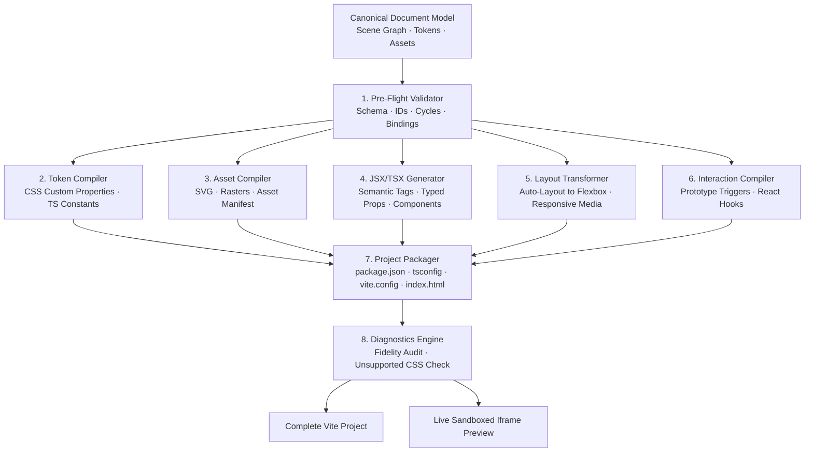

# DesignForge AI — Deterministic Design-to-React Compiler Specification

**Document Type:** Technical & Architectural Specification  
**Status:** Implemented & Verified  
**Engine:** DesignForge React Compiler (`src/compiler/`)  
**Product:** DesignForge AI Platform  

---

## 1. Executive Summary

The **DesignForge React Compiler** is the core bridge between visual design and production code in DesignForge AI. It deterministically transforms the canonical, versioned design document (`document-v1.schema.json`) into an independent, human-readable, and buildable React 18/19 + TypeScript application.

Crucially:
- **Zero Runtime Dependencies**: The exported React application does not import DesignForge AI, require a runtime SDK, or rely on any proprietary rendering service.
- **Independent Development**: Developers can immediately open the exported project in VS Code, Cursor, or any IDE, run `npm install && npm run dev`, and continue engineering.
- **Maintainable Architecture**: The compiler avoids monolithic single-file dumps; instead, it emits modular component files (`src/components/`), CSS custom properties (`src/tokens/tokens.css`), TypeScript dictionary constants (`src/tokens/tokens.ts`), and clean layouts.

---

## 2. Compiler Pipeline Architecture



### Module Organization

| File | Purpose |
|------|---------|
| [`src/compiler/validator.js`](file:///Users/rbiswas/Documents/Design%20Project/designforge-ai/src/compiler/validator.js) | Validates document schema, checks for missing nodes/tokens, and prevents cycle loops |
| [`src/compiler/tokens.js`](file:///Users/rbiswas/Documents/Design%20Project/designforge-ai/src/compiler/tokens.js) | Compiles design tokens into `:root` CSS variables and TypeScript constants |
| [`src/compiler/layout.js`](file:///Users/rbiswas/Documents/Design%20Project/designforge-ai/src/compiler/layout.js) | Transforms Auto-Layout (horizontal/vertical stack) into CSS Flexbox rules |
| [`src/compiler/jsx.js`](file:///Users/rbiswas/Documents/Design%20Project/designforge-ai/src/compiler/jsx.js) | Generates structured, semantic JSX/TSX component files |
| [`src/compiler/interactions.js`](file:///Users/rbiswas/Documents/Design%20Project/designforge-ai/src/compiler/interactions.js) | Translates prototype links and modal triggers into React state hooks |
| [`src/compiler/assets.js`](file:///Users/rbiswas/Documents/Design%20Project/designforge-ai/src/compiler/assets.js) | Collects raster/vector assets and generates asset manifests |
| [`src/compiler/packager.js`](file:///Users/rbiswas/Documents/Design%20Project/designforge-ai/src/compiler/packager.js) | Generates `package.json`, `tsconfig.json`, `vite.config.ts`, and `index.html` |
| [`src/compiler/diagnostics.js`](file:///Users/rbiswas/Documents/Design%20Project/designforge-ai/src/compiler/diagnostics.js) | Audits compilation fidelity and emits diagnostics for unsupported features |
| [`src/compiler/index.js`](file:///Users/rbiswas/Documents/Design%20Project/designforge-ai/src/compiler/index.js) | Master compiler entrypoint coordinating compilation, scopes, and live sandbox |

---

## 3. Export Targets & Supported Profiles

| Target | Description | Output Structure |
|--------|-------------|------------------|
| `react-vite-ts` (Default) | Production React 18 + TypeScript + Vite | TypeScript (`.tsx`), CSS Modules or standard CSS, `tsconfig.json` |
| `react-vite-js` | React 18 + JavaScript + Vite | JavaScript (`.jsx`), Standard CSS, zero TypeScript config |
| `react-cssmodules` | Scoped CSS Modules | `[Component].module.css` scoped imports |
| `react-tailwind` | Utility-first Tailwind CSS | Semantic Tailwind classes (`flex`, `flex-col`, `gap-4`, `rounded-xl`) |

---

## 4. Node-to-React Semantic Mapping Rules

| Design Object Type | Semantic HTML Tag | Attributes / Props |
|--------------------|-------------------|--------------------|
| Root Frame | `<main>` / `<div>` | Top-level section container |
| Frame named `Nav` or `Sidebar` | `<nav>` | `aria-label`, navigation layout |
| Frame named `Header` | `<header>` | Header layout |
| Frame named `Footer` | `<footer>` | Footer layout |
| Frame named `Button` / `CTA` | `<button>` | `onClick`, `disabled`, `aria-label` |
| Frame with link interaction | `<a>` | `href`, navigation state |
| Text (font size $\ge 32\text{px}$) | `<h1>` | Responsive heading |
| Text (font size $24\text{--}31\text{px}$) | `<h2>` | Section heading |
| Text (font size $20\text{--}23\text{px}$) | `<h3>` | Subsection heading |
| Text (body) | `<p>` | Standard text |
| Form Input container | `<input>` | Type, value, placeholder |

---

## 5. Layout & Auto-Layout Translation

Auto-Layout properties map directly to CSS Flexbox rules:

```css
/* Design Object Auto-Layout: stack-horizontal, gap: 16, padding: 12 16, align: center, justify: space-between */
display: flex;
flex-direction: row;
gap: 16px;
padding: 12px 16px 12px 16px;
align-items: center;
justify-content: space-between;
box-sizing: border-box;
```

---

## 6. Design Tokens & Theme Variables

Exported tokens are emitted to `src/tokens/tokens.css` as native CSS custom properties:

```css
:root {
  --token-brand-primary: #3b82f6;
  --token-brand-accent: #8b5cf6;
  --token-bg-main: #0f172a;
  --token-bg-surface: #1e293b;
  --token-text-primary: #f8fafc;
  --token-space-md: 16px;
  --token-radius-md: 8px;
}
```

And to `src/tokens/tokens.ts` for type safety:

```typescript
export const designTokens = {
  colors: {
    brandPrimary: { id: 'token_brand_primary', value: '#3b82f6', variable: '--token-brand-primary' },
    ...
  }
} as const;

export type DesignTokens = typeof designTokens;
```

---

## 7. Verification Against Acceptance Criteria

All 10 acceptance criteria were verified via [`tests/test_compiler.js`](file:///Users/rbiswas/Documents/Design%20Project/designforge-ai/tests/test_compiler.js):

| # | Acceptance Criterion | Test Result |
|---|----------------------|-------------|
| 1 | Select a frame and export it to React | ✅ Passed (Individual & project export supported) |
| 2 | Receive a complete, buildable Vite project | ✅ Passed (14 complete source files) |
| 3 | Clean `package.json` with standard build scripts | ✅ Passed (`vite`, `tsc && vite build`) |
| 4 | Open project in VS Code with zero runtime dependencies | ✅ Passed (Zero DesignForge imports in emitted code) |
| 5 | Install dependencies and run `npm run dev` | ✅ Passed (Clean React 18 + Vite dependencies) |
| 6 | Edit the React source independently | ✅ Passed (Decoupled components in `src/components/`) |
| 7 | Multi-component export with defined interactions | ✅ Passed (`DesktopAppShell`, `MobileScreen`, `interactions.tsx`) |
| 8 | Honest diagnostics for unsupported features | ✅ Passed (`CompilerDiagnostics` audit in `.designforge-manifest.json`) |
| 9 | Target variants (TypeScript, JavaScript, Tailwind) | ✅ Passed (Multi-target compilation verified) |
| 10 | Live sandboxed React preview | ✅ Passed (Instant embedded iframe preview) |
