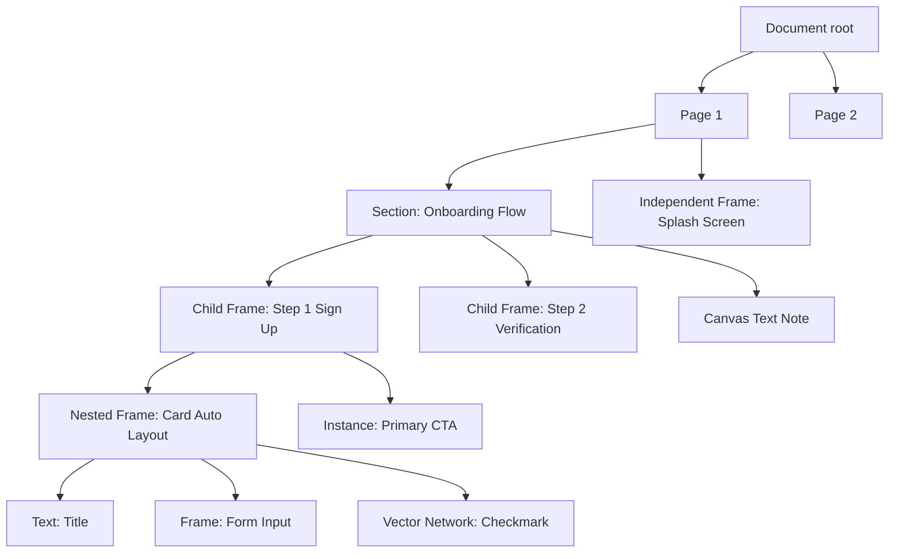

# DesignForge AI — Document Model & Scene Graph Specification (`docs/document-model.md`)

**Document Type:** Core Architectural Specification  
**Domain:** Part A — Document Model, Hierarchy Invariants, Reparenting Mathematics & `.dforge` Schema  
**Status:** Canonical Reference

---

## 1. Unified Scene Graph Hierarchy: Section → Frame → Objects

DesignForge AI implements a strict, deterministic scene graph where the canvas, layers panel, inspector, export pipeline, code compiler, and prototyping runtime share one canonical source of truth.



### 1.1 Node Types

```ts
type NodeId = string;

type NodeType =
  | "DOCUMENT"
  | "PAGE"
  | "SECTION"
  | "FRAME"
  | "GROUP"
  | "COMPONENT"
  | "COMPONENT_SET"
  | "INSTANCE"
  | "BOOLEAN_OPERATION"
  | "SLICE"
  | "RECTANGLE"
  | "ELLIPSE"
  | "LINE"
  | "ARROW"
  | "POLYGON"
  | "STAR"
  | "VECTOR"
  | "TEXT"
  | "IMAGE";
```

### 1.2 Canonical Base Node Interface

All nodes in the document model implement the following standardized schema:

```ts
interface BaseNode {
  id: NodeId;
  type: NodeType;
  name: string;
  parentId: NodeId | null; // Exactly one parent; order = index in parent's childIds
  visible: boolean;
  locked: boolean;
  
  // Transform: Stored strictly RELATIVE to the immediate parent's origin
  x: number;
  y: number;
  rotation: number; // In degrees, clockwise
  width: number;
  height: number;
  
  // Compositing
  opacity: number; // [0, 1]
  blendMode: "NORMAL" | "DARKEN" | "MULTIPLY" | "COLOR_BURN" | "LIGHTEN" | "SCREEN" | "COLOR_DODGE" | "OVERLAY" | "SOFT_LIGHT" | "HARD_LIGHT" | "DIFFERENCE" | "EXCLUSION" | "HUE" | "SATURATION" | "COLOR" | "LUMINOSITY";
  
  // Layout & Constraints
  constraints?: {
    horizontal: "LEFT" | "RIGHT" | "LEFT_RIGHT" | "CENTER" | "SCALE";
    vertical: "TOP" | "BOTTOM" | "TOP_BOTTOM" | "CENTER" | "SCALE";
  };
  layout?: AutoLayoutConfig;
  layoutPositioning?: "AUTO" | "ABSOLUTE"; // ABSOLUTE children ignore Auto Layout flow
  
  // Styling
  fills: Paint[];
  strokes: Paint[];
  strokeWeight: number | { top: number; right: number; bottom: number; left: number };
  strokeAlign: "INSIDE" | "CENTER" | "OUTSIDE";
  strokeCap?: "NONE" | "ROUND" | "SQUARE" | "LINE_ARROW" | "TRIANGLE_ARROW";
  strokeJoin?: "MITER" | "BEVEL" | "ROUND";
  dashPattern?: number[];
  cornerRadius?: number | [number, number, number, number]; // [top-left, top-right, bottom-right, bottom-left]
  cornerSmoothing?: number; // [0, 1] iOS continuous squircle curvature
  effects: Effect[];
  
  // Design Systems & Tokens
  boundVariables: Record<string, VariableBinding>; // property path -> variableId
  styleRefs: {
    fill?: string;
    stroke?: string;
    text?: string;
    effect?: string;
    grid?: string;
  };
  
  // Prototyping & Handoff
  exportSettings: ExportSetting[];
  interactions?: Interaction[];
}
```

---

## 2. Container Hierarchy Rules & Invariants

| Container Type | May Contain | May Be Contained By | Clipping | Auto Layout | Constraints | Notes |
| :--- | :--- | :--- | :--- | :--- | :--- | :--- |
| **Page** | Sections, Independent Frames, Canvas Objects | Document | Infinite Canvas | No | No | Root canvas viewport |
| **Section** | Frames, Groups, Shapes, Text | Page only | No | No | No | Cannot nest inside Section or Frame; organizing flow boundary |
| **Frame** | Frames, Groups, Components, Instances, Shapes, Text | Page, Section, Frame | Optional (`clipContent: true`) | Yes (`stack-horizontal`, `stack-vertical`, `grid`, `wrap`) | Yes (resolves children) | Full design artboard & container |
| **Group** | Any shape or frame | Section, Frame, Group | No | No | No | Bounds derived strictly from bounding box of children |
| **Component** | Same as Frame | Page, Section, Frame | Optional | Yes | Yes | Master source of truth for instances |
| **Instance** | Cloned hierarchy | Section, Frame | Mirrors Master | Mirrors Master | Mirrors Master | Overrides tracked per stable layer ID |

### Core Hierarchy Invariants (Figma Behavioral Parity)

1. **Section Organizing Boundary**:
   - A Section can live ONLY directly on a Page. It can never be nested inside another Section, Frame, or Group.
   - Dropping a Section into a Frame or Section is strictly rejected with a "not allowed" visual state.
   - Moving a Section moves all its child frames and objects transactionally.
   - Deleting a Section deletes its children (with confirmation if non-empty).
   - "Remove Section" keeps the children intact and reparents them directly to the Page.
2. **Frame Categorization**:
   - **Independent Frame**: Center lies on the empty Page canvas. Parent is the Page (`parentId: null` or `rootIds`).
   - **Section Child Frame**: Center lies inside an existing Section's canvas bounds. Parent is the Section.
   - **Nested Frame**: Created or dropped inside an existing Frame. Parent is the enclosing Frame.
3. **Deepest Eligible Container Wins**:
   - When an object is created or dragged, the deepest eligible container containing the object's center point ($x_c, y_c$) is chosen as the parent.
   - Sections accept frames and objects. Frames accept everything except Sections.

---

## 3. Reparenting Algorithm & Coordinate Transforms

When a node is moved between containers, its visual position on the canvas must remain pixel-stable unless joining an Auto Layout flow.

### 3.1 World-to-Local & Local-to-World Mathematics

Given a hierarchy path from root page to node: $P_0 \to P_1 \to \dots \to P_k \to Node$:

$$\mathbf{T}_{\text{world}}(Node) = \sum_{i=0}^{k} \begin{pmatrix} x(P_i) \\ y(P_i) \end{pmatrix} + \begin{pmatrix} x(Node) \\ y(Node) \end{pmatrix}$$

When reparenting $Node$ from old parent $A$ to new parent $B$:

1. Compute absolute world position of $Node$:
   $$\mathbf{X}_{\text{world}} = \mathbf{T}_{\text{world}}(A) + \begin{pmatrix} x_{\text{rel}}(Node) \\ y_{\text{rel}}(Node) \end{pmatrix}$$
2. Compute absolute world position of new parent $B$:
   $$\mathbf{X}_{\text{world}}(B) = \mathbf{T}_{\text{world}}(B)$$
3. Compute new relative coordinates within $B$:
   $$\begin{pmatrix} x_{\text{new\_rel}} \\ y_{\text{new\_rel}} \end{pmatrix} = \mathbf{X}_{\text{world}} - \mathbf{X}_{\text{world}}(B)$$

### 3.2 Reparenting Execution Pipeline

```ts
function reparentNode(
  nodeId: NodeId,
  targetParentId: NodeId | null,
  insertIndex?: number,
  preventReparentModifier: boolean = false
): CommandResult {
  const node = getNode(nodeId);
  const oldParent = node.parentId ? getNode(node.parentId) : null;
  const newParent = targetParentId ? getNode(targetParentId) : null;

  // Invariant 1: Sections cannot be parented to anything other than Page
  if (node.type === "SECTION" && newParent !== null) {
    return { success: false, reason: "Sections cannot be nested inside containers" };
  }

  // Invariant 2: Cannot parent a node to its own descendant (prevent cycles)
  if (newParent && isDescendantOf(newParent.id, nodeId)) {
    return { success: false, reason: "Cannot reparent an ancestor into its own descendant" };
  }

  // If user holds modifier (e.g., Spacebar during drag), suppress reparenting
  if (preventReparentModifier) {
    return { success: true, reparented: false };
  }

  const worldPos = computeWorldCoordinates(node);

  // 1. Remove from old parent childIds
  if (oldParent) {
    oldParent.childIds = oldParent.childIds.filter(id => id !== nodeId);
  } else {
    activePage.rootIds = activePage.rootIds.filter(id => id !== nodeId);
  }

  // 2. Attach to new parent
  if (newParent) {
    node.parentId = newParent.id;
    if (newParent.layout && newParent.layout.mode !== "none" && node.layoutPositioning !== "ABSOLUTE") {
      // Joining Auto Layout: join flow at target index
      if (insertIndex !== undefined) {
        newParent.childIds.splice(insertIndex, 0, nodeId);
      } else {
        newParent.childIds.push(nodeId);
      }
      // Recompute layout flow
      triggerAutoLayout(newParent.id);
    } else {
      // Freeform placement: preserve canvas world position
      const parentWorldPos = computeWorldCoordinates(newParent);
      node.x = worldPos.x - parentWorldPos.x;
      node.y = worldPos.y - parentWorldPos.y;
      if (insertIndex !== undefined) {
        newParent.childIds.splice(insertIndex, 0, nodeId);
      } else {
        newParent.childIds.push(nodeId);
      }
    }
  } else {
    // Reparented to Page root
    node.parentId = null;
    node.x = worldPos.x;
    node.y = worldPos.y;
    if (insertIndex !== undefined) {
      activePage.rootIds.splice(insertIndex, 0, nodeId);
    } else {
      activePage.rootIds.push(nodeId);
    }
  }

  return { success: true, reparented: true };
}
```

---

## 4. Native Project File: `.dforge` Package Schema v1

The `.dforge` project file is an open, versioned ZIP container storing design assets cleanly as raw binary files rather than bloated base64 strings.

```
project-name.dforge (ZIP Archive)
├── manifest.json            <- Format version, software build, asset checksums, timestamps
├── document.json            <- Scene graph, pages, tokens, variables, styles, components
├── prototype/
│   ├── statecharts.json     <- ForgeFlow statechart state machines and transition graphs
│   ├── data.json            <- Mock data collections, repeaters, session stores
│   └── scenarios.json       <- Recorded test flows, assertions, deterministic replay seeds
└── assets/
    ├── img_7f8a9b2c.png     <- High-resolution raster images (binary)
    ├── img_3e4d5c6b.webp    <- Optimized web graphics (binary)
    └── font_inter_var.woff2 <- Embedded font binaries for offline vector text fidelity
```

### 4.1 `manifest.json` Specification

```json
{
  "format": "dforge-package",
  "schemaVersion": "1.0.0",
  "appVersion": "2.0.0",
  "createdAt": "2026-10-23T12:00:00Z",
  "updatedAt": "2026-10-23T12:30:00Z",
  "generator": "DesignForge AI Engine",
  "checksum": "e3b0c44298fc1c149afbf4c8996fb92427ae41e4649b934ca495991b7852b855",
  "assets": [
    {
      "id": "asset_img_01",
      "filename": "assets/img_7f8a9b2c.png",
      "mimeType": "image/png",
      "sizeBytes": 204850,
      "sha256": "4a5e1e...b6c2"
    }
  ]
}
```

### 4.2 `document.json` Specification

```json
{
  "$schema": "https://designforge.ai/schemas/document-v1.json",
  "id": "doc_8f1b2c3d",
  "name": "Enterprise Design System & SaaS Suite",
  "themeMode": "dark",
  "pages": [
    {
      "id": "page_01",
      "name": "Application Architecture & Flows",
      "rootIds": ["sec_01", "frame_splash"],
      "nodes": {
        "sec_01": {
          "id": "sec_01",
          "type": "SECTION",
          "name": "Checkout Flow",
          "parentId": null,
          "visible": true,
          "locked": false,
          "x": 100,
          "y": 100,
          "width": 1800,
          "height": 1200,
          "fills": [{ "type": "solid", "color": "#0f172a" }],
          "childIds": ["frame_cart", "frame_payment"],
          "devStatus": "ready_for_dev"
        },
        "frame_cart": {
          "id": "frame_cart",
          "type": "FRAME",
          "name": "Cart Screen",
          "parentId": "sec_01",
          "visible": true,
          "locked": false,
          "x": 80,
          "y": 120,
          "width": 375,
          "height": 812,
          "clipContent": true,
          "layout": {
            "mode": "stack-vertical",
            "gap": 16,
            "paddingTop": 24,
            "paddingRight": 16,
            "paddingBottom": 24,
            "paddingLeft": 16
          },
          "childIds": ["text_cart_title", "btn_checkout"]
        }
      }
    }
  ],
  "components": [],
  "variables": [],
  "tokens": []
}
```
