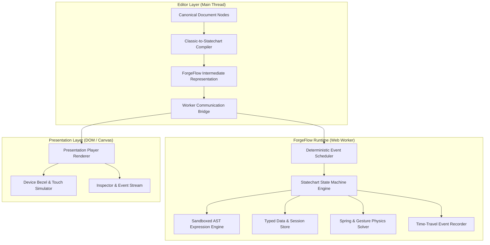

# ForgeFlow Prototyping Engine — Technical Specification & Architecture (`docs/forgeflow-design.md`)

**Package:** `packages/forgeflow` (Independent Prototyping Subsystem)  
**Specification Reference:** Part E & ForgeFlow IR Standard  
**Status:** Canonical Design

---

## 1. Executive Summary & Design Principles

**ForgeFlow** is a deterministic, statechart-based interactive prototyping runtime and simulation engine designed to bridge static vector designs and production software logic.

### Core Architectural Pillars
1. **Decoupled Execution in a Web Worker:** The runtime execution engine, expression solver, and event scheduler run entirely inside a dedicated Web Worker, preventing heavy interaction logic from starving the 60/120 FPS UI canvas.
2. **Statechart Foundation (Harel Statecharts / SCXML / XState):** Classic UI interactions (clicks, hovers) and complex multi-step user journeys are compiled into deterministic statecharts supporting hierarchical states, parallel regions, guards, and history.
3. **Sandboxed Expression Language:** Zero dynamic code execution (`eval` and `new Function` are completely prohibited). All conditional logic and arithmetic are evaluated by a custom Abstract Syntax Tree (AST) tree-walking interpreter.
4. **Time-Travel Debugging & Headless CI Testing:** Every state transition is recorded as an immutable event delta, enabling step-back/step-forward debugging, scenario recording, and automated regression testing in CI without a live browser.

---

## 2. ForgeFlow Architecture Overview



---

## 3. ForgeFlow Intermediate Representation (IR)

The compiler translates design elements and interactions into a normalized, JSON-serializable ForgeFlow IR:

```ts
interface ForgeFlowIR {
  id: string;
  version: "1.0.0";
  initialStateId: string;
  context: {
    variables: Record<string, VariableValue>;
    collections: Record<string, DataCollection>;
    session: Record<string, any>;
  };
  states: Record<string, StatechartNode>;
  transitions: TransitionDefinition[];
  components: Record<string, ComponentStateMachine>;
  flows: FlowDefinition[];
}

interface StatechartNode {
  id: string;
  type: "atomic" | "compound" | "parallel" | "history";
  name: string;
  frameId?: string; // Associated artboard frame
  initialSubstateId?: string;
  entryActions?: ActionDefinition[];
  exitActions?: ActionDefinition[];
  on?: Record<string, TransitionDefinition[]>; // Event -> Transitions
}

interface TransitionDefinition {
  id: string;
  event: string; // 'click', 'hover', 'timeout', 'input_change'
  target: string; // Destination State ID
  guard?: ExpressionAST; // Conditional predicate
  actions?: ActionDefinition[];
  animation?: {
    type: "instant" | "dissolve" | "smart-animate" | "push" | "slide-in" | "slide-out";
    duration: number; // ms
    easing: "linear" | "ease-in" | "ease-out" | "ease-in-out" | "spring";
    spring?: { mass: number; stiffness: number; damping: number };
  };
}
```

---

## 4. Sandboxed Expression Language

To allow logic like `cartTotal = cartTotal + item.price` or `if (user.role === 'admin' && balance > 0)` without executing arbitrary JavaScript:

### 4.1 AST Grammar Definition
The language supports:
- **Literals:** Numbers (`42`, `3.14`), Strings (`"hello"`), Booleans (`true`, `false`), Null.
- **Identifiers:** Variable references (`cartCount`, `theme.mode`, `selectedItem.id`).
- **Binary Operations:** Arithmetic (`+`, `-`, `*`, `/`, `%`), Comparisons (`===`, `!==`, `>`, `<`, `>=`, `<=`), Logical (`&&`, `||`).
- **Unary Operations:** Not (`!`), Negation (`-`).
- **String Concatenation & Template Strings:** Concatenation with `+`.
- **Built-in Functions:** `min(a, b)`, `max(a, b)`, `clamp(val, min, max)`, `round(n)`, `abs(n)`, `length(str)`.

### 4.2 AST Node Structure & Evaluator
```ts
type ExpressionAST =
  | { type: "Literal"; value: any }
  | { type: "Identifier"; name: string }
  | { type: "MemberAccess"; object: ExpressionAST; property: string }
  | { type: "BinaryExpression"; operator: string; left: ExpressionAST; right: ExpressionAST }
  | { type: "UnaryExpression"; operator: string; argument: ExpressionAST }
  | { type: "CallExpression"; callee: string; arguments: ExpressionAST[] };

function evaluateAST(ast: ExpressionAST, context: ExecutionContext): any {
  switch (ast.type) {
    case "Literal":
      return ast.value;
    case "Identifier":
      return context.getVariable(ast.name);
    case "MemberAccess":
      const obj = evaluateAST(ast.object, context);
      return obj ? obj[ast.property] : undefined;
    case "BinaryExpression":
      const l = evaluateAST(ast.left, context);
      const r = evaluateAST(ast.right, context);
      switch (ast.operator) {
        case "+": return l + r;
        case "-": return l - r;
        case "*": return l * r;
        case "/": return r !== 0 ? l / r : 0;
        case "===": return l === r;
        case "!==": return l !== r;
        case ">": return l > r;
        case "<": return l < r;
        case ">=": return l >= r;
        case "<=": return l <= r;
        case "&&": return Boolean(l && r);
        case "||": return Boolean(l || r);
      }
  }
}
```

---

## 5. Classic Trigger-to-Action Compiler

Designers authoring prototypes via simple click-and-drag interactions should not be required to manually define statecharts. The compiler automatically converts classic triggers into robust statecharts:

1. **Screen-to-Screen Navigation:**
   - Source Frame $A$ and Target Frame $B$ become Compound States $S_A$ and $S_B$.
   - Clicking node $N \in A$ pointing to $B$ creates a transition:
     `{ event: 'click', sourceNode: N.id, target: 'S_B', animation: 'smart-animate' }`.
2. **Interactive Component Variants:**
   - Component set (e.g., Button with `Default`, `Hover`, `Pressed`, `Disabled`) compiles to a self-contained parallel sub-state machine inside the instance.
   - Hover and press transitions operate locally without triggering screen changes.
3. **Overlays & Modals:**
   - Overlays compile into a dedicated parallel region `OverlayManager` with states `None` and `Active(targetFrameId)`.
   - Backdrop click outside triggers `{ event: 'click_outside', target: 'None' }`.

---

## 6. Time-Travel Debugger & Scenario Testing Engine

### 6.1 State Recording & Replay
Every dispatched event produces an immutable transition record:
```ts
interface TransitionRecord {
  step: number;
  timestamp: number;
  event: string;
  sourceNodeId: string;
  prevStateId: string;
  nextStateId: string;
  contextDelta: Record<string, { before: any; after: any }>;
}
```
The debugger exposes:
- **Step Back / Step Forward:** Reverts context variables and active states to any historical step.
- **Export Deterministic Replay:** Exports a standalone `.json` execution trace reproducing bugs with zero ambiguity.

### 6.2 Headless Scenario Runner in CI
Allows automated verification of multi-step flows without opening a browser:
```ts
const runner = new ForgeFlowHeadlessRunner(compiledIR);
runner.dispatch('click', 'btn_login');
assert.strictEqual(runner.getCurrentState(), 'state_dashboard');
runner.dispatch('click', 'btn_open_menu');
assert.strictEqual(runner.getActiveOverlay(), 'frame_nav_drawer');
```

---

## 7. Presentation Player & Device Frames

- **Interactive Stage:** Device frame bezels for Desktop (1440×900), iPad (768×1024), iPhone 15 Pro (375×812), and Fluid Responsive.
- **Controls:** Present mode toolbar with flow selector, back navigation, restart (`↺`), reset state (`⚡`), and diagnostic console.
- **Keyboard Shortcuts:** `Alt+Cmd/Ctrl+Enter` to launch Present mode, `Esc` to exit, `R` to restart.
